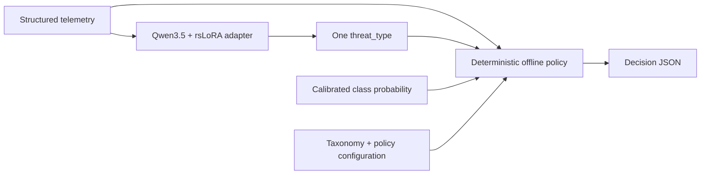
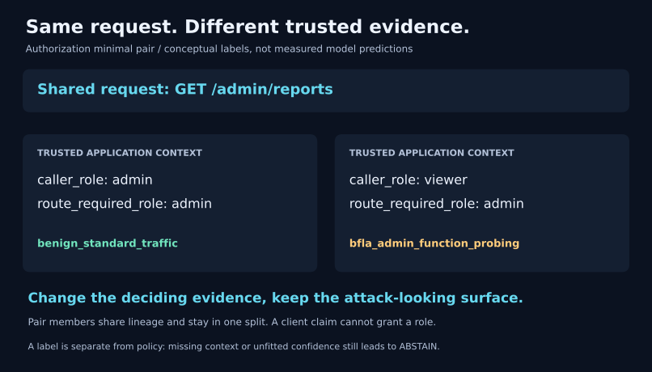

# 1. System and concepts

[Learning index](README.md) · Next: [Data and splits](02-data-and-splits.md)

## The problem this project solves

A web application firewall (WAF) examines application traffic, while a network intrusion detection system (NIDS) examines network behavior. This project explores a shared classifier for both kinds of evidence. It is an offline research pipeline: its Python decision wrapper does not drop requests, configure a proxy, or install firewall rules.

The central separation is between **classification** and **decision**:



The model learns a label. Code derives its domain, checks context and confidence, and chooses a recommendation. This makes policy behavior inspectable without retraining the model.

## Three views of an input

| Mode           | Evidence                                                   | Example question                                                      |
| -------------- | ---------------------------------------------------------- | --------------------------------------------------------------------- |
| `L7_HTTP`    | Structured request fields and applicable context           | Is this request using an input in an injection context?               |
| `L4_FLOW`    | Measured or simulated flow features and observation window | Does this activity resemble scanning or beaconing?                    |
| `HYBRID_CTX` | Application telemetry joined with relevant history/context | Do the request and trusted authorization evidence support this class? |

Each class has allowed modes in [taxonomy.yaml](../config/taxonomy.yaml). The policy abstains when the emitted class is incompatible with the supplied mode.

A missing feature is absent, not an invented zero. A zero-duration flow cannot support a computed packets-per-second rate. A TCP flag bitmask says which flags appeared; it does not say how many packets carried each flag. See the feature units and limitations in [features.yaml](../config/features.yaml).

## The model's entire answer

```json
{"threat_type":"benign_hard_negative_dev"}
```

There is exactly one key, and its value must be a current taxonomy key. The four benign classes remain separate:

| Benign class                    | Distinction to learn                                  |
| ------------------------------- | ----------------------------------------------------- |
| `benign_standard_traffic`     | Ordinary legitimate activity                          |
| `benign_hard_negative_dev`    | Developer content that resembles attack syntax        |
| `benign_hard_negative_search` | Legitimate search/prose with suspicious-looking terms |
| `benign_high_rate_legit`      | Legitimate activity whose rate resembles abuse        |

The other 37 classes span injection, API/protocol abuse, modern AI/application threats, and network-flow behavior. The configuration defines precedence and exclusions between neighboring classes; a keyword alone is insufficient.

`unknown` is a policy abstention outcome, not a 42nd supervised class. A number generated as part of an answer would not establish calibrated confidence; this project obtains confidence from model scores separately.

## Why context changes the answer



This illustration is a conceptual teaching example, not a measured model prediction. A trusted application may know the caller's role and a route's required role. The same request from an administrator and from an unprivileged user can therefore have different interpretations. The client's own claim that it is authorized cannot supply that trusted context.

The project generates benign twins and harder minimal pairs to discourage learning “admin path means attack.” Twins share lineage with their parent, so they leave training together if that lineage is held out.

## Find your way around

| Directory                 | Responsibility                                                          |
| ------------------------- | ----------------------------------------------------------------------- |
| `config/`, `schemas/` | Taxonomy, source contracts, features, and accepted record/output shapes |
| `data_pipeline/`        | Download, parse, normalize, generate, deduplicate, and split            |
| `subagents/`            | Scenario jobs, review, quarantine, and cross-model review tooling       |
| `datasets_ready/`       | Derived JSONL files, manifest, and dataset statistics                   |
| `training/`, `colab/` | Rendering, masks, bundles, training, and fresh-process checks           |
| `eval/`                 | Baselines, coverage, shortcut audit, calibration, and policy            |
| `tests/`, `reports/`  | Executable checks and evidence from previous runs                       |

**Check your understanding:** Why can a schema-valid model answer still require abstention? It may have an unsupported mode, missing required context, no fitted threshold, or insufficient calibrated confidence.

Sources: [prompt preparation](../training/prepare.py), [output schema](../schemas/classification.schema.json), [policy](../eval/policy.py), [master specification](PLAN.md).
