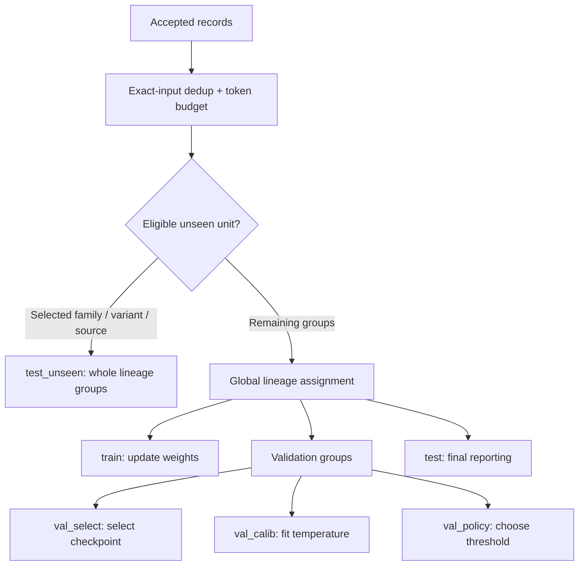

# 2. Data and split design

[Learning index](README.md) · Previous: [Concepts](01-system-and-concepts.md) · Next: [Training](03-training.md)

## Follow one record

1. **Ingest evidence.** `ingest_public.py` downloads configured, pinned sources into `../raw_cache/`. It records provenance; downloaded payload text stays inert.
2. **Normalize or parse.** `normalize.py` prepares seed strings and groups related variants. `flows.py` converts supported capture features, checks units and source-label consistency, and records unsupported mappings.
3. **Build scenarios.** `generate.py` creates deterministic examples; `subagents/orchestrator.py` ingests reviewed scenario output. Review status controls quarantine and accepted relabels.
4. **Assemble records.** A system message, serialized telemetry, and one assistant classification form `messages`. Label evidence, source, generator, and lineage remain outside the user message.
5. **Deduplicate and budget.** `build.py` removes exact serialized-input duplicates and rejects examples exceeding the 2,048-token full-sequence budget.
6. **Hold out and split.** `dedup_and_split.py` reserves eligible unseen units, then assigns remaining whole lineage groups globally to train, validation, and test.
7. **Validate.** The pre-Colab gate checks the files currently on disk. Audit and baseline commands provide additional evidence; a gate pass does not establish correct labels by itself.

## Where the record's information goes

```text
record
├── id                    tracking identifier; not a model feature
├── messages
│   ├── system            constant instructions + allowed classes
│   ├── user              [MODE] + serialized telemetry
│   └── assistant         {"threat_type":"..."}
└── metadata              label, evidence, source, lineage, split, token length
```

During training, the assistant answer is the supervised target. At inference, only the system and user messages form the prompt. Annotation rationale, proposed labels, and review keys must never become telemetry. [prepare.py](../training/prepare.py) applies the pinned tokenizer's chat template and reversibly escapes reserved control strings in user data.

## Provenance describes evidence, not quality

| Type | Meaning | Example |
|---|---|---|
| `observed` | Telemetry parsed from a capture/source record | Supported flow fields from a real capture |
| `synthetic` | Scenario or features constructed for the task | Simulated network behavior or a generated application case |
| `hybrid` | Real seed material in generated context | A published seed placed in a constructed HTTP request |

A real seed does not turn its generated wrapper into an observed request. A source's “DDoS” label also cannot automatically establish SYN flooding or UDP amplification. The measured features must support the narrower taxonomy class.

In this checkout, SYN flood, UDP amplification, and HTTP/2 rapid-reset examples are synthetic-only according to the progress log. Synthetic examples improve coverage but cannot establish representative production performance.

## Split by family before judging the model

A random row split could put one seed in training and a lightly encoded descendant in test. The model would then receive credit for recognizing a familiar family. The implementation uses `metadata.lineage_group` to keep related items together, including attack/benign twins and groups spanning multiple classes.



The nominal remaining-pool ratio is 80/10/10, with minimum-group rules and roughly 2:1:1 validation allocation. Whole groups, cross-class lineage, and unseen holdouts mean actual row proportions differ. Validation subpartitions live together in `fast_val.jsonl`; their `metadata.split` distinguishes them.

`test_unseen` holds out eligible scenario families, synthetic variants, or sources under the current rules. Its coverage is conditional: some classes lack a suitable independent unit. The current implementation has newer source-holdout logic than the stored build; the progress log says that change takes effect on rebuild. Do not treat stored counts as a run of newer code.

## Current stored snapshot


| Split | Records | Allowed use |
|---|---:|---|
| `train` | 31,004 | Gradient updates |
| `val_select` | 1,825 | Checkpoint/model selection |
| `val_calib` | 1,003 | Temperature fitting |
| `val_policy` | 1,032 | Threshold choice |
| `test` | 5,033 | Frozen evaluation |
| `test_unseen` | 2,668 | Generalization reporting |
| **Total** | **42,565** | Core only; robustness is separate |

Source: the initially inspected `datasets_ready/manifest.json` and [statistics](../datasets_ready/dataset_stats_report.json), inspected 15 October 2026. The manifest was subsequently removed during a separate rebuild. The visual's [snapshot JSON](assets/dataset-snapshot.json) records hashes of the retained statistics and gate evidence so it can be recognized as historical after a rebuild.

## Four checks that answer different questions

| Check | What it can tell you | What it cannot establish |
|---|---|---|
| Pre-Colab gate | Schema, hashes, labels in prompts, masking, token budget, detected overlap | Semantic truth of every annotation |
| Label review | Agreement and evidence problems under a review protocol | Independent ground truth from same-model agreement |
| Shortcut audit | Whether surface structure predicts classes | That low shortcut accuracy eliminates all shortcuts |
| Baselines/coverage | Simple-model performance and diversity gaps | Quality of an untrained fine-tuned model |

Use the precise claim **“zero detected cross-split overlap under the documented checks (exact input hash + lineage group).”** Public base-model contamination and semantic overlap can remain.

**Check your understanding:** Why must a benign twin leave training with its attack parent? Keeping either member in training exposes the held-out scenario and weakens the evaluation.

Sources: [build](../data_pipeline/build.py), [split logic](../data_pipeline/dedup_and_split.py), [gate](../tests/validate_pre_colab.py), [review](../subagents/review.py).
