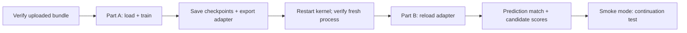

/st

# 3. Training and checkpoints

[Learning index](README.md) · Previous: [Data](02-data-and-splits.md) · Next: [Evaluation](04-evaluation-and-policy.md)

## What rsLoRA changes

The notebook loads the pinned `unsloth/Qwen3.5-4B` base and trains small adapter matrices on selected projections. It keeps the base weights frozen instead of updating all four billion parameters.

Conceptually, a projection becomes `y = W x + (alpha / sqrt(r)) B A x`. `W` is the frozen base projection; `A` and `B` are the learned low-rank update. Rank `r` controls the update's size. This is the rank-stabilized scaling selected by `use_rslora=True`.

The local settings in [colab_helpers.py](../training/colab_helpers.py) are:

| Setting            | Current value                                                                             |
| ------------------ | ----------------------------------------------------------------------------------------- |
| Rank / alpha       | `r=16`, `lora_alpha=32`                                                               |
| Adapter settings   | `use_rslora=True`, dropout `0`, bias `none`                                         |
| Target projections | `q_proj`, `k_proj`, `v_proj`, `o_proj`, `gate_proj`, `up_proj`, `down_proj` |
| Base loading       | 16-bit; `load_in_4bit=False`                                                            |
| Sequence budget    | 2,048 tokens including the full conversation/template                                     |
| Initial schedule   | One epoch, learning rate `1e-4`, cosine decay, 5% warmup                                |
| Effective batch    | 16 on the notebook's single GPU                                                           |

This is 16-bit rsLoRA, not a 4-bit QLoRA run. Hardware-dependent settings and package pins describe this checkout's implementation; inspect [requirements.lock](../requirements.lock) and run a compatibility check before changing the stack.

## Read the loss mask


The model can attend to the prompt, but training loss applies only to the assistant answer and end-of-turn token. `-100` marks ignored labels; it is different from an attention mask. Padding receives ignored labels and an attention-mask value of zero.

`tokenize_with_mask()` renders both the inference prompt and full conversation with the checkpoint's own template, asserts that prompt tokens are a prefix of the full sequence, and supervises only the suffix through EOS. A trailing newline after EOS is ignored. `check_record()` also checks that reserved strings in telemetry did not create extra conversation turns.

Mask errors can produce a decreasing loss while optimizing the wrong objective. Token-budget enforcement therefore happens on the full rendered sequence, not just the HTTP body or JSON answer. Oversized core records are rejected rather than silently losing their evidence.

## Microbatch versus effective batch

For one GPU, `effective batch = per-device batch × gradient accumulation`.

| Memory tier        | Per-device batch | Accumulation | Effective batch |
| ------------------ | ---------------: | -----------: | --------------: |
| Under 20 GiB       |                1 |           16 |              16 |
| 20 to under 30 GiB |                2 |            8 |              16 |
| 30 to under 60 GiB |                4 |            4 |              16 |
| 60 GiB or more     |                8 |            2 |              16 |

The helper uses fixed memory tiers, not an automatic fit probe. A chosen batch must divide 16. Larger microbatches change padding and memory behavior and still need a dry run. The notebook selects FP16 on the T4 and BF16 only when the device checks support it.

## Why the notebook has two parts



[Part A](../colab/partA.ipynb) trains and exports. [Part B](../colab/partB.ipynb) loads the exported adapter in a fresh process, compares stored predictions/fingerprints, and scores class completions. Smoke mode additionally compares uninterrupted training against save/reload continuation. A second model beside the training process can exceed T4 memory, so the restart is an operational requirement.

The notebook's default `MODE="smoke"` performs a short check. `MODE="fast"` uses the fast bundle. `DRY_RUN_STEPS` exercises a limited run on that bundle. A full-run branch exists, but its requested filenames refer to planned full artifacts; producing arbitrary `full_*.jsonl` files is insufficient. Match notebook paths and validated artifacts before a full run.

## Checkpoint and export serve different purposes

| Artifact            | Purpose                                                                                       |
| ------------------- | --------------------------------------------------------------------------------------------- |
| Training checkpoint | Resume with adapter/model state, optimizer, scheduler, RNG, and trainer progress              |
| Adapter export      | Reload the learned adapter with the matching base, tokenizer, and configuration for inference |

The notebook saves by step interval and elapsed time. Complete-checkpoint markers protect resume selection; Drive copies keep the newest two completed checkpoints when configured. Only completed, compatible checkpoints are eligible for continuation. An adapter export alone cannot reproduce training progress.

The stored [GPU smoke report](../reports/gpu_smoke_test.json) records T4 execution, a 5/5 reload prediction match, and a continuation loss comparison within its tolerance. It supports “notebook smoke-tested” for that recorded run. It does not validate every newer bundle, establish final accuracy, or guarantee runtime on another GPU.

## Second model: Gemma 4 E2B-it on a TPU v5e-1 (manual run)

A comparison model on Colab's TPU v5e-1 (16 GB HBM), with JAX + Tunix + Qwix instead of PyTorch + Unsloth. Qwen3.5
cannot train on a TPU (its linear-attention kernels are CUDA-only; see the 15 October probe in the PLAN progress log);
Gemma 4 E2B has standard attention, and Tunix ships its config (`gemma4_e2b_it`: per-layer embeddings, KV-shared
layers) and a Hugging Face safetensors loader. Code: [data export](../training/gemma_tpu/data.py),
[trainer and scorer](../training/gemma_tpu/train_tunix.py). No notebook: the steps below run through the `colab` CLI
(18 October: `colab new -s gemmatpu --tpu v5e1`, uploads, `colab exec` of a short Python cell that starts the trainer
as a detached subprocess, then polling its log).

Locally (CPU), after a build that passed the gate:

```bash
.venv/bin/python -m training.gemma_tpu.data --prefix fast_   # -> reports/gemma_tpu/data/ (11 MB)
```

It re-serialises each user turn with Gemma's control strings, applies Gemma's chat template (`<|turn>` ... `<turn|>`,
native system role) and writes fixed-shape buckets of 512 / 1,024 / 2,048 tokens (XLA compiles once per shape).
18 October build: train 23,945 / 11,785 / 900 records, 7 over budget in all splits.

In a Colab notebook with a TPU v5e-1 runtime:

1. `pip install git+https://github.com/google/tunix@ba95987a5a3f1d3cf8a680238c1600a0db6453af qwix==0.1.8`
   (PyPI `google-tunix` 0.1.7 lacks `skip_lm_head`, which the trainer needs). It upgrades the image's jax 0.7.2 to
   0.11.0 with libtpu 0.0.44.1 and flax 0.12.8: restart the kernel afterwards.
2. Upload `reports/gemma_tpu/data/*` (as one tgz) to `/content/data/` and `training/gemma_tpu/train_tunix.py` to
   `/content/`. The base checkpoint downloads from the Hub at the pinned revision in `meta.json` (Apache-2.0, not gated).
3. **Never import jax in the notebook kernel**: it takes the TPU, and the trainer then fails with
   `TPU is already in use by process ...`. Start the trainer as a subprocess (`subprocess.Popen(..., start_new_session=True)`).
4. `python train_tunix.py probe 10` -> `/content/out/probe.json`. 18 October: load 27 s, first step (compile)
   52-66 s per bucket, 17.4 / 8.5 / 3.7 records/s at 512 / 1,024 / 2,048 tokens (~8.9k tokens/s), HBM peak 9.5 of
   15.75 GB, epoch estimate 0.84 h.
5. Small end-to-end test: `GEMMA_LIMIT=64 GEMMA_CKPT_EVERY=5 GEMMA_OUT=/content/out_small python train_tunix.py train`
   (first 64 records per bucket: 12 steps, checkpoint, `lora.npz`, scoring). Rerunning the same line resumes from
   `ckpt.npz` (checked: `resumed at step 10 micro 52`).
6. `GEMMA_CKPT_EVERY=500 python train_tunix.py train` -> `/content/out/lora.npz`, `train_log.jsonl`,
   `SCORES_val.jsonl`, `SCORES_test.jsonl`, `SCORES_test_unseen.jsonl`. The checkpoint is on the VM disk: it
   survives a crashed process, not a lost runtime. Download `/content/out/` before the runtime ends.

Fixes the first run needed (all in `train_tunix.py`): qwix creates LoRA params lazily on its dummy call, and Tunix's
`RematConfig.BLOCK` wraps blocks in `nnx.remat(graph_updates=False)`, which discarded them (first step: `Cannot find
rngs`), so LoRA is applied with remat off and BLOCK is switched on afterwards. `nnx.jit` returned the whole model
state, an undonated copy of the 8.7 GB weights per call (17.8 GB temporaries even at 1 x 512): the trainer now splits
the model (`nnx.split`) and jits pure functions of (LoRA fp32 master weights, frozen bf16 weights) that return only
the loss and the accumulated LoRA gradient (3.8-4.4 GB temporaries). Compute dtype bf16 (Tunix's default config is
f32); the LM head runs only at the K answer positions with f32 accumulation.

Recipe (matches the Qwen run where the stack allows): LoRA r16 on q/k/v/o and gate/up/down, qwix alpha 8 r (the rsLoRA
scale alpha/sqrt(r) = 8), AdamW 1e-4 cosine, 5% warmup, weight decay 0.01, clip 1.0, effective batch 16 records,
1 epoch, block rematerialisation. The loss projects only the K = 20 answer positions through the LM head
(`skip_lm_head`): Tunix's default loss builds a one-hot over the 262k vocabulary at every position. Scoring uses the
Qwen scorer's pruning (shared answer prefix + first class token for every class, the rest only for classes within
12 nats), so the scores files have the same format as Qwen's.

Then locally, merge the three files (one header line) and calibrate like the Qwen runs (T on `val_calib`, threshold
on `val_policy`; rows carry each record's own split):

```bash
(head -1 out/SCORES_val.jsonl; tail -qn +2 out/SCORES_{val,test,test_unseen}.jsonl) > reports/gemma_tpu/SCORES_fast.jsonl
.venv/bin/python -m eval.calibration reports/gemma_tpu/SCORES_fast.jsonl     # no --write-policy: Qwen owns config/policy.yaml
```

It writes `reports/calibration.json` (the Qwen report's path): copy the Qwen one aside first, or move the result to
`reports/gemma_tpu/calibration.json` right after.

Compare test / test_unseen accuracy, false interventions and ECE with Qwen v10 and the next Qwen version.

**Check your understanding:** If the model reads prompt tokens, why are their training labels `-100`? Attention uses the prompt as context; the loss should reward producing the answer rather than reproducing the input.

Sources: [rendering and masks](../training/prepare.py), [Gemma TPU path](../training/gemma_tpu/), [training helpers](../training/colab_helpers.py), [notebook generator](../colab/make_notebook.py), [packaging](../training/make_bundle.py).
