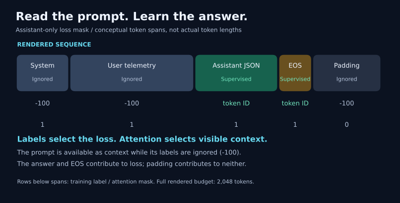
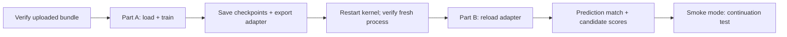

/st

# 3. Training and checkpoints

[Learning index](README.md) · Previous: [Data](02-data-and-splits.md) · Next: [Evaluation](04-evaluation-and-policy.md)

## What rsLoRA changes

The notebook loads the pinned `unsloth/Qwen3.5-4B` base and trains small adapter matrices on selected projections. It keeps the base weights frozen instead of updating all four billion parameters.

Conceptually, a projection becomes `y = W x + (alpha / sqrt(r)) B A x`. `W` is the frozen base projection; `A` and `B` are the learned low-rank update. Rank `r` controls the update's size. This is the rank-stabilized scaling selected by `use_rslora=True`.

The local settings in [colab_helpers.py](../training/colab_helpers.py) are:

| Setting            | Current value                                                                             |
| ------------------ | ----------------------------------------------------------------------------------------- |
| Rank / alpha       | `r=16`, `lora_alpha=32`                                                               |
| Adapter settings   | `use_rslora=True`, dropout `0`, bias `none`                                         |
| Target projections | `q_proj`, `k_proj`, `v_proj`, `o_proj`, `gate_proj`, `up_proj`, `down_proj` |
| Base loading       | 16-bit; `load_in_4bit=False`                                                            |
| Sequence budget    | 2,048 tokens including the full conversation/template                                     |
| Initial schedule   | One epoch, learning rate `1e-4`, cosine decay, 5% warmup                                |
| Effective batch    | 16 on the notebook's single GPU                                                           |

This is 16-bit rsLoRA, not a 4-bit QLoRA run. Hardware-dependent settings and package pins describe this checkout's implementation; inspect [requirements.lock](../requirements.lock) and run a compatibility check before changing the stack.

## Read the loss mask

The model can attend to the prompt, but training loss applies only to the assistant answer and end-of-turn token. `-100` marks ignored labels; it is different from an attention mask. Padding receives ignored labels and an attention-mask value of zero.

`tokenize_with_mask()` renders both the inference prompt and full conversation with the checkpoint's own template, asserts that prompt tokens are a prefix of the full sequence, and supervises only the suffix through EOS. A trailing newline after EOS is ignored. `check_record()` also checks that reserved strings in telemetry did not create extra conversation turns.

Mask errors can produce a decreasing loss while optimizing the wrong objective. Token-budget enforcement therefore happens on the full rendered sequence, not just the HTTP body or JSON answer. Oversized core records are rejected rather than silently losing their evidence.

## Microbatch versus effective batch

For one GPU, `effective batch = per-device batch × gradient accumulation`.

| Memory tier        | Per-device batch | Accumulation | Effective batch |
| ------------------ | ---------------: | -----------: | --------------: |
| Under 20 GiB       |                1 |           16 |              16 |
| 20 to under 30 GiB |                2 |            8 |              16 |
| 30 to under 60 GiB |                4 |            4 |              16 |
| 60 GiB or more     |                8 |            2 |              16 |

The helper uses fixed memory tiers, not an automatic fit probe. A chosen batch must divide 16. Larger microbatches change padding and memory behavior and still need a dry run. The notebook selects FP16 on the T4 and BF16 only when the device checks support it.

## Why the notebook has two parts

[Part A](../colab/partA.ipynb) trains and exports. [Part B](../colab/partB.ipynb) loads the exported adapter in a fresh process, compares stored predictions/fingerprints, and scores class completions. Smoke mode additionally compares uninterrupted training against save/reload continuation. A second model beside the training process can exceed T4 memory, so the restart is an operational requirement.

The notebook's default `MODE="smoke"` performs a short check. `MODE="fast"` uses the fast bundle. `DRY_RUN_STEPS` exercises a limited run on that bundle. A full-run branch exists, but its requested filenames refer to planned full artifacts; producing arbitrary `full_*.jsonl` files is insufficient. Match notebook paths and validated artifacts before a full run.

## Checkpoint and export serve different purposes

| Artifact            | Purpose                                                                                       |
| ------------------- | --------------------------------------------------------------------------------------------- |
| Training checkpoint | Resume with adapter/model state, optimizer, scheduler, RNG, and trainer progress              |
| Adapter export      | Reload the learned adapter with the matching base, tokenizer, and configuration for inference |

The notebook saves by step interval and elapsed time. Complete-checkpoint markers protect resume selection; Drive copies keep the newest two completed checkpoints when configured. Only completed, compatible checkpoints are eligible for continuation. An adapter export alone cannot reproduce training progress.

The stored [GPU smoke report](../reports/gpu_smoke_test.json) records T4 execution, a 5/5 reload prediction match, and a continuation loss comparison within its tolerance. It supports “notebook smoke-tested” for that recorded run. It does not validate every newer bundle, establish final accuracy, or guarantee runtime on another GPU.

**Check your understanding:** If the model reads prompt tokens, why are their training labels `-100`? Attention uses the prompt as context; the loss should reward producing the answer rather than reproducing the input.

Sources: [rendering and masks](../training/prepare.py), [training helpers](../training/colab_helpers.py), [notebook generator](../colab/make_notebook.py), [packaging](../training/make_bundle.py).
