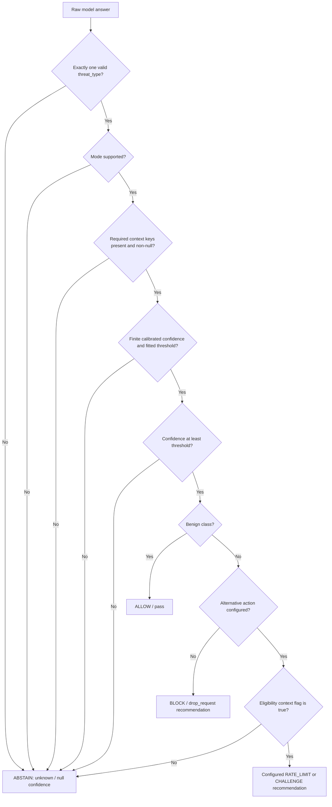

# 4. Evaluation and policy

[Learning index](README.md) · Previous: [Training](03-training.md) · Next: [Hands-on](05-hands-on.md)

## Separate the questions

**Classification:** Did the model emit the correct taxonomy key in valid JSON?

**Calibration:** Do model-derived probabilities reflect correctness on the evaluated data?

**Policy:** With a frozen threshold and required context, what would the offline system recommend, and at what cost in false interventions and missed attacks?

The current shipped policy has a null temperature and threshold. Valid labels can still be useful shadow predictions, but supported decisions abstain until calibration and threshold selection are completed.

## From class scores to confidence

The notebook's B1s cell scores every allowed JSON answer under the same prompt. For class `c`, it sums the log probabilities of that class's completion tokens, including the supervised end-of-turn token. Scores are **not length-normalized**. The cached implementation checks selected scores against a full forward pass.

Temperature scaling converts the vector of scores into probabilities:

```text
p(c | telemetry) = exp(score[c] / T) / sum_j exp(score[j] / T)
```

`eval/calibration.py` fits positive `T` on `val_calib` by minimizing negative log likelihood. It chooses a threshold on `val_policy`, then reports `test`, `test_unseen`, and robustness outcomes without tuning on them.

Temperature changes probability sharpness, not score ranking. The policy's confidence is the calibrated probability of the **emitted class**, obtained with `calibrated_confidence()`. Calibration on one dataset does not guarantee reliability after a traffic distribution shift, and closed-set softmax is not an open-set detector.

## Follow the wrapper's checks



`parse_output()` performs no JSON repair and rejects extra keys or unknown taxonomy values. `decide()` returns both a decision and diagnostics. Abstention places the tentative class in diagnostics while the public decision uses `UNKNOWN`, `unknown`, and null confidence.

The wrapper checks **presence**, not the truth of contextual evidence. Its caller must supply trusted context and valid calibrated probabilities; it is not a complete telemetry validator. Alternative action eligibility specifically requires a true flag. Validate the resulting object with `validate_decision()` against its schema and taxonomy domain mapping.

| Verdict | Action string |
|---|---|
| `ALLOW` | `pass` |
| `BLOCK` | `drop_request` |
| `RATE_LIMIT` | `rate_limit_ip` |
| `CHALLENGE` | `challenge_captcha` |
| `ABSTAIN` | `log_and_monitor` |

These are offline recommendations. The repository contains no live enforcement path for them. `rule_hint` is a fixed descriptive code, not generated executable rule text.

## Flow envelope and ensembles

A flow the model calls `benign_standard_traffic` also has to lie inside the **flow envelope**: the 0.5–99.5% range of
benign training flows per feature (rates, sizes, duration). Outside it, the wrapper abstains, because out-of-taxonomy
floods land in the background class with high confidence. Exporters round time: NetFlow and IPFIX record
milliseconds, CICFlowMeter microseconds. A recorded duration of 0 therefore means "under 1 ms", so
`outside_envelope()` treats it as the interval [0, 1 ms) and counts the flow as outside only if no duration in that
interval fits. Its missing rates are then above total / 1 ms, and it counts as outside if that already exceeds the
rate bound. Policy key `flow_envelope_resolution: {}` restores exact comparison.

An **ensemble policy** (`config/policy_ensemble.yaml`, built by `eval/ensemble.py`) averages the members' calibrated
distributions, each with its own frozen temperature. It re-tempers the mean and then decides like a single model,
with its own temperature and threshold fitted on `val_calib` and `val_policy`. `eval.policy.decide_from_probs()`
is the one decision path for the endpoint and for offline re-decisions of benchmark results
(`eval/public_bench.py redecide | gemma | ensemble | compare`).

## Read metrics without fooling yourself

| Metric | Meaning | Important limit |
|---|---|---|
| Accuracy | Fraction of correct class predictions | Can hide weak minority classes |
| Macro-F1 | F1 averaged equally across classes | Read it alongside per-class counts and errors |
| Raw JSON validity | Fraction of unmodified answers that parse and satisfy the output contract | Valid JSON can still predict the wrong class |
| False-intervention rate | Intervened benign records / all benign records | Keep benign subclasses and provenance visible |
| Attack intervention recall | Intervened attack records / all attack records | Abstained attacks remain unmitigated |
| Coverage | Fraction receiving a non-abstain decision | All-abstain can look safe while covering nothing |
| ECE / Brier / NLL | Different views of probability reliability | Include binning, sample sizes, and distribution limits |

The calibration helper's `policy_rates()` is a **confidence-threshold simulation**, not a replay of all context gates in `decide()`. Its hard-negative threshold mask selects the two `benign_hard_negative*` classes; report `benign_high_rate_legit` separately too. The specification requires broader subclass and uncertainty reporting than this one helper supplies.

Compare the fine-tuned model with the text SVM and the HTTP-only CRS baseline on shared eligible inputs. High scores on a separable synthetic class can reflect surface patterns; inspect matched benign twins, confuser sets, and `test_unseen` before claiming semantic understanding. A simple baseline can reveal a dataset problem before GPU time is spent.

The separate robustness set probes missing evidence, unsupported classes, malformed/truncated inputs, and attempts to instruct the classifier through telemetry. It must not be mixed into the 41-class core confusion matrix or used to fit the temperature/threshold. Some cases have acceptable behavior sets; inspect their metadata as well as the scorer's aggregate low-confidence abstention report.

**Check your understanding:** Why not choose the threshold on test? Doing so adapts the policy to its exam, making the reported test outcome optimistic.

Sources: [candidate scorer](../training/colab_helpers.py), [calibration](../eval/calibration.py), [policy wrapper](../eval/policy.py), [decision schema](../schemas/decision.schema.json), [acceptance targets](PLAN.md).
