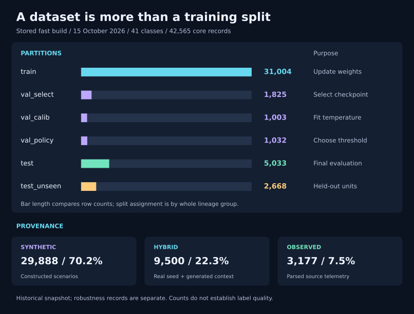

# Learn the Qwen3.5 WAF / NIDS project

This repository turns HTTP requests and network-flow telemetry into a security class, then uses a separate Python policy to recommend an action. Start here if you want to understand the system before building data or running the notebook.

## Start with the plain-language guides

New to AI or security? Start with [Learning from the beginning](learning/README.md). It explains the purpose, training, examples, and evaluation through everyday situations, with no coding required. It includes a worked example and practice questions with answers.

## Technical learning path

| Read | You will learn | Follow the code |
|---|---|---|
| [1. System and concepts](01-system-and-concepts.md) | What the model sees, predicts, and leaves to policy | `training/prepare.py`, `config/taxonomy.yaml` |
| [2. Data and split design](02-data-and-splits.md) | Sources, provenance, review, twins, and leakage checks | `data_pipeline/`, `subagents/` |
| [3. Training and checkpoints](03-training.md) | rsLoRA, token masks, batches, and the two-part notebook | `training/`, `colab/` |
| [4. Evaluation and policy](04-evaluation-and-policy.md) | Class scores, calibration, abstention, and honest metrics | `eval/`, `config/policy.yaml` |
| [5. Hands-on walkthrough](05-hands-on.md) | Small local exercises without training a model | Existing helpers and reports |
| [Glossary](glossary.md) | The vocabulary used throughout the project | — |

Follow the chapters in order, then run the exercises. Commands assume your working directory is `qwen35-waf-ml/` and use the existing Python 3.12 `.venv`.

## Visual library

- [Interactive pipeline](diagrams/pipeline.html): download/open the HTML in a browser for zoom, search, theme switching, and export. Repository Markdown previews do not execute HTML.
- [Dataset snapshot](assets/dataset-snapshot.svg): split sizes and provenance from the checked-in reports.
- [Training loss mask](assets/loss-mask.svg): which parts of a conversation contribute to training loss.
- [Minimal pairs](assets/minimal-pairs.svg): why the same request can have different labels when trusted authorization context changes.
- Editable Mermaid diagrams appear in the chapters. [Diagram sources and checks](diagrams/README.md) explain maintenance.

## Recorded project state

Snapshot inspected on **15 October 2026**; these are stored results, not experiments rerun for these learning docs.

| Item | Evidence in this checkout |
|---|---|
| Taxonomy | **41 classes**, including four benign classes, in [taxonomy.yaml](../config/taxonomy.yaml) |
| Last complete inspected dataset | **42,565 records**, `fast_` prefix, captured in the [documentation snapshot](assets/dataset-snapshot.json) |
| Data gate | Stored report: passed, zero failures, in [pre_colab_gate.json](../reports/pre_colab_gate.json) |
| Notebook smoke test | Stored T4 run passed, including reload and continuation, in [gpu_smoke_test.json](../reports/gpu_smoke_test.json) |
| Full model evaluation | Pending according to the [progress log](PLAN.md) |
| Decision policy | `threshold: null`, `temperature: null`: shadow mode in [policy.yaml](../config/policy.yaml) |

The completion sequence is **data-ready → notebook smoke-tested → model-evaluated → deployment-qualified**. A passing data gate or a short GPU smoke test does not establish model quality.

During documentation work, `datasets_ready/manifest.json` disappeared after its initial inspection, consistent with a separate rebuild starting. These counts describe the previously inspected complete build. If the manifest is absent, the build is incomplete; if a new manifest exists, rerun its gate before claiming current data readiness. A retained old gate report is insufficient.

[PLAN.md](PLAN.md) remains the master specification and progress log. Its original body describes a 35-class, 120k-record target; later progress entries and the current configuration describe the 41-class implementation. The `fast_` name is a run profile, not a guarantee of exactly 30,000 rows. Read the current manifest for actual counts. The full-training dataset and deployment qualification remain separate work.

These guides explain local implementation and stored evidence. They do not certify upstream licenses, package availability, or production accuracy.
