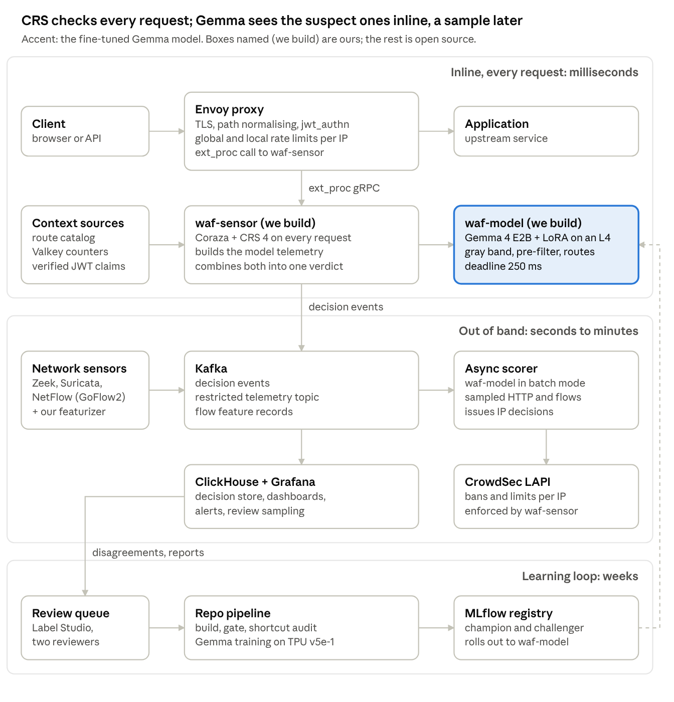
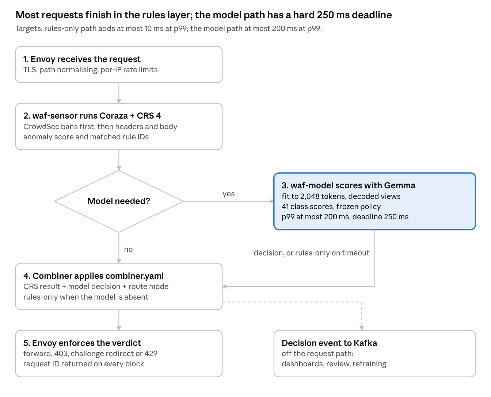
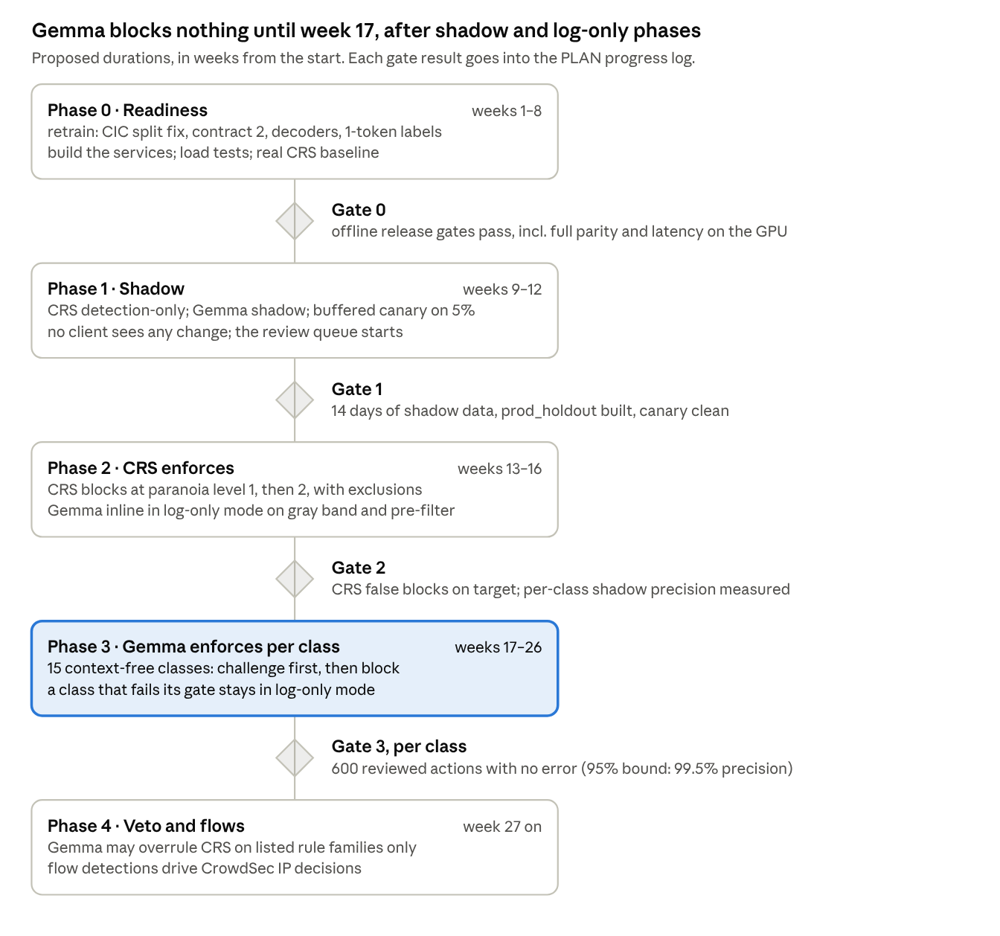

# Gemma WAF System Plan

Proposal, 19 October 2026, revised after review the same day. The diagrams in `assets/waf-system/` are renders of the editable originals.

## Summary

OWASP CRS 4 on the Coraza engine checks every request inline. It is embedded in our own sensor behind an Envoy proxy. The fine-tuned Gemma 4 E2B classifier is a second opinion. Inline, it sees three kinds of request:

- requests CRS scores in the gray band;
- requests a cheap deterministic pre-filter marks as suspect;
- every request on routes the catalog marks model-required.

Out of band, it scores sampled traffic and network flows. Requests CRS would block are scored only out of band until Phase 4, when the model may overrule CRS. Before that, its answer could not change the action.

Every layer is a maintained open-source project. We write four pieces; the full list with owners is in Components and owners:

1. **waf-sensor** (Go): Coraza + CRS, the CrowdSec ban check, request capture, the pre-filter, and the decision combiner, a library inside it.
2. **waf-model** (Python): the repo's scorer (`training/gemma_tpu/hf_scorer.py` plus `eval.policy.decide_from_probs`) behind gRPC, in an inline and an async pool.
3. **Flow featurizer**: maps Zeek, Suricata or NetFlow records onto the model's flow features (`config/features.yaml`).
4. **Feedback tooling**: redaction, review sampling into Label Studio, and the "report a wrong block" endpoint.

**What Gemma must prove before it acts**

- **Fewer false blocks than CRS.** The repo's approximate CRS cross-check (regex rules only, 143 compiled) saw at least one rule fire on 49% of developer hard negatives and 12% of benign records. Those records are synthetic and built to resemble attacks, and "a rule fired" is not an anomaly-score block. Phase 0 measures real Coraza + CRS 4.25 at paranoia levels 1 and 2 on the same records and on real legitimate traffic.
- **Detection CRS lacks.** On held-out synthetic data Gemma blocks 98.3% of attacks and wrongly blocks 0.10% of benign records (`reports/gemma_tpu/REPORT.md`). The comparison with CRS is fair only once both run on the same records.
- **What it will not do inline.** It does not catch, inline, a request CRS misses that none of the three triggers selects. Those requests are found out of band, minutes later. A one-shot exploit both miss is the job of virtual patches (Operations).

**Gemma is not ready to enforce yet**

- It lets real CIC-IDS2017 port scans (0 of 500) and SSH/FTP brute force (0 of 470) through. That split bug is fixed in the build but not retrained.
- **Training and serving decode requests differently.** Training data also carries URL, form, JSON-unicode and chunked decoded views; the serving path produces only JWT and Base64 views.
- **Unmeasured on real hardware and traffic.** Its GPU latency, its false-block rate on real traffic and its share of over-budget requests are unknown. The Qwen models put 4.2 to 5.6% of real browsing requests over budget under sensor contract 1.

Phase 0 (8 weeks) fixes these. It retrains once, with single-token class labels, before the model touches any decision.

## Goals, non-goals and service levels

The system must block web attacks with fewer false blocks than CRS alone. A WAF fault must never silently remove inspection.

**Goals**

- Detect all 37 attack classes of the taxonomy (`config/taxonomy.yaml`): 13 L7 injection, 11 API/protocol, 4 AI/modern and 9 network-flow classes. Enforce on the 15 classes that need no trusted context once each passes its gate (Appendix A).
- Cut CRS false positives on developer content, search text and many-cookie browsing traffic. Let the model overrule CRS only where it saw everything CRS matched.
- Keep every verdict explainable: a fixed reason code, the CRS rule IDs, the model's class and calibrated confidence, and the model version. The model never writes free text into a decision.
- Close the loop: reviewed false positives and misses flow back into the repo's data pipeline, the next training run and gated promotion.

**Non-goals**

- **Volumetric DDoS at L3/L4.** SYN floods and UDP amplification stay with the upstream provider or CDN. The model's flow classes only raise alerts for them, because their source addresses are spoofed or belong to reflectors.
- **Authorization decisions.** BOLA stays with the application, which alone knows object ownership. BFLA belongs to the gateway's RBAC on verified roles, and mass assignment to schema validation. The model flags these classes; it does not enforce them.
- **Response inspection by the model.** It reads requests and flows only. CRS outbound rules stay available but off at launch.
- **Rules or text written by the model.** It ranks 41 labels; it never generates.
- **Full bot management.** The challenge action is a proof-of-work page, not device fingerprinting.
- **Production use of the Qwen3.5 v11 model.** It stays an offline comparison and an optional ensemble member.

**Service levels.** These are proposed targets; the right column shows the evidence the repo holds today.

| Measure | Target | Evidence today |
| --- | --- | --- |
| Added latency, rules layer (Envoy + Coraza + CRS) | p99 ≤ 10 ms; sensor CPU sized from Phase 0 load tests | Not measured for our stack. CrowdSec's out-of-process, Coraza-based CRS added +33 ms mean and +58 ms p90 per GET at 400 concurrent users, so this target needs proof |
| Added latency, inline model path | p99 ≤ 200 ms; hard deadline 250 ms, then the rules-only verdict | Gemma not measured on a GPU. Qwen v10 on its SageMaker endpoint (A10G): 0.21 s median, 0.33 s p90 |
| Share of requests the model sees inline | Set from Phase 1 shadow data. Planning figure: 5% of traffic, plus all traffic of model-required routes | Unknown. The 12% CRS fire rate above comes from synthetic records |
| False blocks on real legitimate traffic (enforced classes) | ≤ 0.1% of requests | v10: 0.57% of open-appsec's 10,380 legitimate requests. Gemma: not measured |
| False blocks, benign held-out set | ≤ 0.2% | Gemma: 0.10% (test_unseen, attack-mass rule) |
| Attack recall on held-out families and sources | ≥ 98% | Gemma: 98.3%; Qwen v11 + Gemma ensemble: 99.0% |
| Requests too long for the model | ≤ 1% | Qwen v10/v11, contract 1: 4.2 to 5.6%. Gemma: not measured. Contract 2 is written, not trained |
| Data-plane availability | 99.95% monthly | The sensor runs with at least 3 replicas per zone, because fail-closed routes depend on it (Failure behaviour) |
| Model-path availability | 99.5% monthly; an outage only removes the second opinion | n/a |

All failure behaviour is collected in one table, in the Failure behaviour section.

## At a glance



A request crosses only the top band. Gemma is called inline for gray-band requests, pre-filter hits and model-required routes; a timeout leaves the rules-only verdict. Everything below the top band runs off the request path.

## Building blocks

Every layer is a maintained open-source project with a permissive or well-understood license. Versions and the alternatives we rejected are in Appendix B.

| Layer | Choice | License | Why |
| --- | --- | --- | --- |
| Edge proxy | [Envoy](https://github.com/envoyproxy/envoy) via [Envoy Gateway](https://github.com/envoyproxy/gateway) | Apache-2.0, CNCF | ext_proc is stable and has a shadow mode with no added latency. Rate limits, `jwt_authn` and OpenTelemetry logs are built in |
| Rule engine | [OWASP Coraza](https://github.com/corazawaf/coraza), embedded in waf-sensor | Apache-2.0 | Go library compatible with CRS v4. No Wasm overhead |
| Rules | [OWASP CRS](https://github.com/coreruleset/coreruleset), LTS line | Apache-2.0 | Anomaly scoring, paranoia levels, exclusion plugins. Security fixes until Q3 2027 |
| Classifier | Gemma 4 E2B-it + our LoRA | Apache-2.0 | Trained and evaluated in this repo |
| Model runtime | [Transformers](https://github.com/huggingface/transformers), then [vLLM](https://github.com/vllm-project/vllm) | Apache-2.0 | Transformers carries the repo's parity tests. vLLM only after it passes full parity |
| GPU platform | Kubernetes with the [NVIDIA GPU Operator](https://github.com/NVIDIA/gpu-operator), [KEDA](https://github.com/kedacore/keda), [Karpenter](https://github.com/kubernetes-sigs/karpenter) | Apache-2.0 | One operator installs driver, device plugin and DCGM. KEDA (CNCF graduated) scales on queue depth |
| IP reputation | [CrowdSec](https://github.com/crowdsecurity/crowdsec) local API + community blocklist | MIT | Shared blocklist and time-limited decisions our async scorer can write |
| Rate limiting | [envoyproxy/ratelimit](https://github.com/envoyproxy/ratelimit) + Valkey | Apache-2.0; BSD-3-Clause | One bucket per client IP across all Envoy pods |
| Challenge page | [Anubis](https://github.com/TecharoHQ/anubis) | MIT | Mature proof-of-work proxy |
| Network sensors | [Zeek](https://github.com/zeek/zeek), [Suricata](https://github.com/OISF/suricata) + ET Open, [GoFlow2](https://github.com/netsampler/goflow2) | BSD-3; GPL-2.0 (rules MIT); BSD-3 | Measured fields that map onto the model's flow features |
| Streaming | [Apache Kafka](https://github.com/apache/kafka) | Apache-2.0 | KRaft only; ClickHouse reads it with its Kafka table engine |
| Telemetry | [OpenTelemetry Collector](https://github.com/open-telemetry/opentelemetry-collector-releases), [Prometheus](https://github.com/prometheus/prometheus), Jaeger | Apache-2.0 | Envoy sends OTLP access logs natively |
| Decision store, dashboards | [ClickHouse](https://github.com/ClickHouse/ClickHouse), [Grafana](https://github.com/grafana/grafana) | Apache-2.0; AGPL-3.0 (internal use) | Analytics over every decision event |
| Labelling and MLOps | [Label Studio](https://github.com/HumanSignal/label-studio), [MLflow](https://github.com/mlflow/mlflow), [Evidently](https://github.com/evidentlyai/evidently) | Apache-2.0 | Text labelling; registry aliases; drift reports |
| Supply chain and secrets | [cosign](https://github.com/sigstore/cosign), [Syft](https://github.com/anchore/syft), [Grype](https://github.com/anchore/grype), [Kyverno](https://github.com/kyverno/kyverno), [OpenBao](https://github.com/openbao/openbao), [cert-manager](https://github.com/cert-manager/cert-manager) | Apache-2.0; OpenBao MPL-2.0 | Signed images and model packages, SBOMs, scans, admission checks, secrets, mTLS |
| Testing | [GoTestWAF](https://github.com/wallarm/gotestwaf), [go-ftw](https://github.com/coreruleset/go-ftw), [open-appsec WAF comparison corpus](https://github.com/openappsec/waf-comparison-project) | MIT; Apache-2.0 | Attack suites, CRS regression tests, a large legitimate-traffic corpus |

## Components and owners

Every running piece has one owning role. Names replace the roles once they are assigned (an open question).

| Component | What it does | Built or run | Owner |
| --- | --- | --- | --- |
| Envoy, Envoy Gateway | Edge proxy, TLS, rate limits, `jwt_authn`, ext_proc | Run | Platform team |
| waf-sensor | Coraza + CRS, ban check, capture, pre-filter, decision combiner (a library inside it) | Build, Go | Security engineering |
| waf-model, inline and async pools | Gemma scoring and policy. The async pool also writes IP decisions to CrowdSec, the only writer allowed | Build, Python | ML team |
| Flow featurizer | Zeek, Suricata and NetFlow records to flow telemetry | Build, Python | ML team with network operations |
| Route catalog and its CI check | `x-waf-*` route metadata, schema-checked on every change | Build | Each application team; schema by security engineering |
| Redaction library | Strips secrets before every store except the review store | Build | Security engineering |
| Review sampler and Label Studio importer | Picks review items, imports them, exports labels to the repo | Build | ML team |
| Report-a-block endpoint | Public form keyed by request ID; rate-limited, behind the challenge | Build | Security engineering |
| Labelling | Two reviewers plus adjudication | People | SOC analysts and ML team |
| CrowdSec, ratelimit + Valkey, Kafka, ClickHouse, OTel Collector, Prometheus, Grafana | Shared infrastructure | Run | Platform team |
| Zeek, Suricata, GoFlow2 | Network sensors | Run | Network operations and SOC |
| MLflow, Evidently | Registry and drift reports | Run | ML team |
| Kill switch, virtual patches, runbooks | Emergency controls | Run | Security engineering on-call |

## Inline HTTP path



**When the model is needed inline**, highest priority first:

1. **A model-required route**, as the catalog marks it.
2. **A pre-filter hit**, even at CRS score 0. These are cheap, deterministic triggers, and their share of traffic is measured in shadow:
   - a decoded view was produced (Base64, JWT, double URL-encoding)
   - a serialized-object or XML DOCTYPE marker
   - a GraphQL body
   - a body on an admin route
3. **The gray band**: some rules fired, below the CRS threshold.

Requests at or above the CRS threshold go only to async scoring until Phase 4: before vetoes exist, the model's answer cannot change a CRS block. Under load, the lowest priority is shed first. Per-client caps on model calls and body windows stop one client from filling the queue.

**Envoy settings** (Envoy 1.40 through Envoy Gateway 1.9; one `EnvoyExtensionPolicy` with `extProc` per route class):

- **Request body.** Request headers `SEND`; request body `BUFFERED`, with the route's accepted body limit as the buffer limit. A larger body is rejected with 413, so no byte reaches the application uninspected.
- **Upload routes are the one exception.** They use `BUFFERED_PARTIAL`: the first 64 KiB is inspected, and file parts must have an allowed content type. The catalog names the uninspected remainder as an accepted risk, route by route.
- **`message_timeout`: 300 ms.** The default of 200 ms is below the model deadline plus CRS time. waf-sensor enforces the 250 ms model deadline itself and always answers in time.
- **Fail closed by default.** Only routes on the catalog's fail-open list (public GET/HEAD, static assets, health checks) fail open. Every fail-open pass is counted and alerted (Failure behaviour).
- **Shadow phase.**
  - `observability_mode` (Envoy Gateway `shadowMode`) runs on all traffic and adds no latency, but it supports only a streamed body.
  - A detection-only canary on 5% of traffic therefore runs the real `BUFFERED` settings, so the enforcement path is tested before Phase 2.
- **Client IP.**
  - It comes from Envoy's original-IP detection, with the trusted hop count set to the real chain (CDN, load balancer), or from the PROXY protocol on the load balancer. Never from the raw `X-Forwarded-For`.
  - IPv6 clients are grouped by /64 for rate limits and bans.
- **Verdicts.**
  - Block: `ImmediateResponse` 403 with the request ID.
  - Rate limit: 429 with `Retry-After`.
  - Challenge: 302 to the Anubis page.
  - Allow: the request continues, and dynamic metadata carries the decision to the access log.
- **Rate limits.** Local token buckets run before ext_proc, so a flood is cut before it reaches the sensor. Global per-IP buckets use `envoyproxy/ratelimit` with Valkey. Its image is pinned by digest, as it has had no versioned release since v1.4.0.
- **IP bans.** waf-sensor is the only enforcer of IP decisions. It reads the CrowdSec local API in stream mode and caches the decisions locally. Floods at L3/L4 are the upstream provider's job.

**CRS settings** (Coraza 3.8.1 in waf-sensor; CRS 4.25 LTS, supported until Q3 2027; CRS 4.30, the newest, runs in staging only):

- **Anomaly scoring** with the default inbound threshold of 5.
- **Body limits.** `SecRequestBodyLimit` equals the route's limit, with `SecRequestBodyLimitAction Reject` (never `ProcessPartial`).
- **Argument limit.** Coraza 3.8's `SecArgumentsLimit` is 1,000 by default. A rule blocks any request over it, so extra arguments are never skipped silently; Phase 0 verifies Coraza's behaviour with go-ftw.
- **Rollout.** Phase 1 runs `SecRuleEngine DetectionOnly` with a detection paranoia level of 2. Phase 2 turns the engine on: the threshold starts high and steps down to 5, and the blocking paranoia level goes from 1 to 2.
- **Early blocking.** `tx.early_blocking` stays off until tuning is done: it hides the later-phase matches tuning needs.
- **Exclusions** come from the official CRS 4 plugins (WordPress, Nextcloud, Drupal and others) where those applications run. Our runtime exclusions (`ctl:ruleRemoveTargetById`) go before CRS.
- **Regression tests.** go-ftw tests every exclusion. Its quantitative mode counts false positives per rule and paranoia level on a benign corpus and gates CI against a baseline.

## Failure behaviour

No failure silently removes inspection from a fail-closed route. The trade-off is plain: a sensor outage makes fail-closed routes unavailable. That is why the sensor runs with at least 3 replicas per zone, with disruption budgets and canary deploys.

| Component or event | Behaviour | Per-route override | Alert |
| --- | --- | --- | --- |
| waf-sensor unreachable, or slower than the 300 ms timeout | Fail-closed routes: 503. Fail-open routes: the request passes uninspected and is counted | The catalog's fail-open list | Fail-open passes above 0.1% of a route's requests for 5 minutes |
| waf-sensor CPU saturated | Local rate limits shed first; the sensor's admission cap returns a fast 503 on fail-closed routes | — | CPU above 70% for 10 minutes; the autoscaler adds replicas |
| waf-model late (250 ms) or down | Rules-only verdict | Model-required routes may choose a challenge instead | Deadline misses above 1% of model calls for 5 minutes |
| A model package fails its startup self-check | The pod never becomes ready; the previous version keeps serving | — | Any failure |
| CrowdSec local API down | The sensor keeps its last decision cache; new bans wait | — | Decision stream older than 5 minutes |
| Rate-limit service down | Global limits stop; local limits still apply | — | Any error |
| Kafka down | Inline traffic is unaffected. Events are buffered in the sensor up to a bound, then dropped and counted | — | Any dropped event |
| Route catalog change is invalid | CI rejects it; the sensor keeps the last good version | — | Rejected deploy |
| Kill switch engaged | As set by on-call (Operations) | — | Always pages |

## Sensor and telemetry contract

The sensor captures raw fields within byte limits, and waf-model applies every transform the model saw in training. Today training and serving do not share one implementation:

- **Training** (the generator, `data_pipeline/generate.py`) writes URL (depth 1 to 2), form, JSON-unicode and chunked views.
- **Serving** (`training.prepare.add_decoded_views`, used by the SageMaker endpoint) writes only JWT and Base64 views.

Phase 0 moves every decoder into one module used by the generator, the build and waf-model, and adds a parity test on captured ext_proc requests.

**Fields** (`schemas/telemetry.schema.json`). The model input carries telemetry only. A missing value is an absent key, never a zero.

| Field | Production source | Rule |
| --- | --- | --- |
| `schema_version`, `mode` | Sensor | `L7_HTTP`; `HYBRID_CTX` when `context` is attached; `L4_FLOW` on the flow path |
| `decision_stage`, `observed_until` | Sensor | `request_headers` or `request_headers_body`. `observed_until` is the fixed token `request_received`, as canonicalised in training (`subagents/orchestrator.py`) |
| `http.method`, `http.target` | Envoy `:method`, `:path` | Raw path and query as received, never decoded or normalised |
| `http.protocol` | Envoy stream info | Canonical tokens `HTTP/1.1`, `HTTP/2`, `HTTP/3` |
| `http.headers` | ext_proc header map | Rendered the way training renders them: `Host` first (from `:authority` on HTTP/2), training's name case, duplicates kept, other pseudo-headers left out. Envoy lower-cases names, so the parity test checks this |
| `http.query`, `http.cookies` | Parsed by waf-model from the target and `Cookie` | Ordered pairs, duplicates kept, raw values |
| `http.body`, `body_encoding` | ext_proc buffered body | The whole body up to the route's limit; larger bodies were rejected earlier. `utf8`, or `base64` for non-UTF-8 bytes |
| `context.edge` | TLS inspector, IP-to-ASN and geo lookup | `tls_version`, `client_asn_type`, `geo`: the neutral keys training uses (`data_pipeline/generate.py`) |
| `context.route` | Route catalog | `auth`, `rate_limit_tier` |
| `history.client_requests_60s` | Valkey counter per client | Only when it is known at decision time |

**How much of a request the model sees** (`training/prepare.py`, contract 2 from the next build):

- **Budget.** Every prompt fits 2,048 tokens. Cookie values are capped first, then header values (512 down to 64 characters), the body (4,000 down to 400) and the URL (1,024 down to 128), over four levels. The last level keeps the first 48 cookies and records `cookies_truncated`.
- **Run collapsing.** Runs of more than 64 identical characters collapse to 64. That defeats single-character padding only; varied filler stays.
- **Windows.** A long body is cut into windows of 3,000 characters, at most 8, head and tail always included. On a 64 KiB body the model therefore sees about 24,000 characters in 8 evenly spaced pieces. CRS sees the whole body, and the combiner never lets a partial view overrule CRS.
- **Over budget.** A request that still fits no budget gets ABSTAIN with reason `over_token_budget`; the rules-only verdict stands.

**Trusted context.** Twelve classes need a named context key (`required_context` in `config/policy_gemma.yaml`) and abstain without it. All twelve stay log-only until two things hold:

- a context dictionary (in the style of `config/features.yaml`) shows that the keys and value shapes the sensor emits occur in training;
- a retrain on sensor-shaped context has passed its gates.

Training contexts were written by generator models, not by a sensor. The client never supplies context: a header saying "I am admin" is request data.

| Class | Context key | Production source |
| --- | --- | --- |
| `bfla_admin_function_probing` | `caller_role`, `route_required_role` | Verified JWT claim (`jwt_authn`); the role the route requires, from the catalog. Gateway RBAC enforces |
| `bola_idor_enumeration` | `authz_context` | None before the request reaches the application, which alone knows ownership. Out of enforcement scope |
| `bopla_mass_assignment` | `object_schema` | OpenAPI request schema of the route. Schema validation enforces |
| `jwt_auth_bypass` | `verifier_config` | Issuer, algorithms and JWKS of the `jwt_authn` provider, which also rejects bad tokens itself |
| `http_request_smuggling` | `parser_stack` | Declared proxy chain per listener, e.g. `envoy -> gunicorn` |
| `open_redirect_cors` | `browser_or_cors_config` | The route's CORS policy and redirect allowlist |
| `web_cache_poisoning` | `cache_config` | CDN or cache key configuration |
| `xss_dom_polyglot`, `csv_formula_injection` | `sink_context` | Catalog: how the field is rendered or exported |
| `llm_prompt_injection` | `trust_boundary` | Catalog: which inputs reach an LLM, with what tools |
| `mcp_agentic_tool_abuse` | `tool_manifest` | The MCP server's registered tool list |
| `race_condition_toctou_burst` | `route_semantics` | Catalog: e.g. single-use redemption |

## Model serving

Phase 0 retrains Gemma with one reserved token per class, so a single forward pass scores all 41 classes. It serves first on Hugging Face transformers, where the repo's parity checks live, and moves to vLLM only if vLLM passes full parity.

**The model.** [Gemma 4 E2B-it](https://raw.githubusercontent.com/huggingface/blog/main/gemma4.md), released 2 April 2026 under Apache-2.0.

- 2.3B effective parameters, 5.1B counting the per-layer embeddings.
- 35 layers; the last 20 reuse another layer's keys and values.
- 128K context; we use 2,048 tokens.
- Our adapter: LoRA rank 16, trained with Tunix on a TPU v5e-1 and stored as `lora.npz` in the qwix layout. `training/gemma_tpu/hf_scorer.py` maps it onto the Hugging Face layers. A test proves the hooked model equals the merged weights.

**How the current adapter scores** (`hf_scorer.class_scores`):

1. **Pass 1** reads the prompt plus the answer prefix all classes share. It gives every class's first-token log-probability.
2. **Pass 2** completes the multi-token class names, but only for classes within 12 nats of the best. It recomputes the whole prompt for each class it keeps.
3. **The decision.** Summed log-probabilities go through a softmax at T = 1.038391, then the attack-mass rule and `decide_from_probs`.

**Speed path.** Each step must pass the release gates, including full parity, before it serves.

| Step | When | Change | Evidence and condition |
| --- | --- | --- | --- |
| 1 | Phase 0 | Retrain on the next build with single-token labels; the same build carries the CIC split fix, contract 2 and the unified decoders. Serve on transformers 5.17 (the repo pin), bf16, text-only, LoRA merged at load, micro-batches of up to 8 | One pass instead of two. Recalibrate and rerun every gate |
| 2 | After Gate 0 | vLLM 0.32 single-token scoring (Gemma 4 with LoRA since 0.19) with the shared system prompt prefix-cached | Only if it passes full parity. On Qwen v10, vLLM's generation path moved probabilities by up to 0.249 and changed 2 of 400 act-or-abstain decisions. vLLM also skips its prefix cache for prompt-logprob requests |
| 3 | Optional | FP8 weights and activations (supported on the L4), or Google's QAT W4A16 base | Scores change: recalibrate and rerun every gate |

If single-token labels miss a gate, the fallback is the current two-pass adapter with pass 2 reusing the prompt's KV cache. That change took Qwen v10's scorer from 3.56 to 4.27 records/s on an L4 with all 400 top classes unchanged.

**Runtimes considered**

| Runtime | Gemma 4 E2B + LoRA | Verdict |
| --- | --- | --- |
| Hugging Face transformers 5.17 | Yes; parity tested on CPU (`tests/test_gemma_hf.py`) | Phase 0 default |
| vLLM 0.32 | Yes | After full parity |
| SGLang 0.5.22 | LoRA off for the text model; the multimodal model assumes one MLP width, which E2B's double-wide shared layers may break | Not now |
| Hugging Face TGI | Archived on 21 March 2026 | Avoid |
| llama.cpp, OpenVINO, ONNX Runtime GenAI | E2B supported; the llama.cpp server returns no prompt log-probabilities | CPU fallback after single-token labels |

**Deployment.**

- **Two pools**: inline, and async with batches of 16 to 32 fed from Kafka. An async backlog never delays an inline call.
- **One pod per NVIDIA L4** (`g6.xlarge`: 24 GB GPU, 4 vCPU, 16 GiB). The vLLM recipe asks for 24 GB for E2B in bf16.
- **Kubernetes stack**: the NVIDIA GPU Operator, Karpenter for GPU nodes, and KEDA scaling on queue depth.
- **Inline floor**: 4 replicas, two per zone in two zones.
- **No T4s**: they have no bf16, and Gemma 4 in fp16 is untested.

**Package, parity and startup.**

- **Package contents**: `lora.npz`, the frozen policy, `serving.json` (sensor contract, decoded views), the tokenizer fingerprint and the self-check records. `deploy/package_meta.py` builds this for Qwen; Gemma needs its own variant.
- **Signing**: the package is signed with cosign and verified at load.
- **Base weights**: a pinned revision mirrored to an internal bucket. No Hub access at runtime.
- **Release parity gate**: scores on all of test and test_unseen (10,257 records), with the same decision on at least 99.9% of records. Any flip must sit within 0.05 of τ.
- **Startup smoke test**: the 8-record self-check (same top class, probability shift under 0.05) runs at every start. The pod is ready only if it passes.

**API.** gRPC `Score(telemetry, route_mode, deadline_ms)` returns the decision, the 41 probabilities and the time per stage. Health, readiness and Prometheus metrics sit on a side port.

**SageMaker today.**

- **What exists.** `deploy/deploy.sh` deploys Qwen v11, or Qwen v11 and Gemma together (`ENSEMBLE=1`, `ml.g6e.xlarge` at $2.6054/h). The ensemble package has never been deployed.
- **What is missing.** There is no Gemma-only package; writing one is Phase 0 work. A Gemma-only endpoint on `ml.g6.xlarge` would cost $1.1267/h, against $0.8048/h for EC2 `g6.xlarge`.
- **Why it still matters.** The AWS account has no EC2 GPU quota, so SageMaker is the bridge until it does.

**Qwen as a second member** raises held-out recall to 0.990 offline (`config/policy_ensemble.yaml`). It doubles GPU cost, and the ensemble has never run on a GPU. Not for launch.

## Decision layer

CRS decides alone until Phase 3. Then Gemma gains authority one class at a time, and each step is earned on reviewed shadow data. The combiner is a pure function of three inputs, frozen in a signed `combiner.yaml` and pinned by a truth-table test.

**Inputs**

- **CRS result**: inbound anomaly score, matched rule IDs and their paranoia levels, and the variables each rule matched.
- **Model decision**: from `eval.policy.decide_from_probs`. That is a verdict, the class, a calibrated confidence and a fixed reason code, plus the input facts: truncated or not, number of windows, cookies dropped. Gemma's frozen policy (`config/policy_gemma.yaml`) applies:
  - temperature 1.038391
  - the attack-mass rule, threshold τ 0.877
  - the flow envelope and the required-context table
  - a known scanner User-Agent turns a benign verdict into log-and-monitor, never a block
- **Route policy** from the catalog: the enforcement mode, the fail mode, whether the route is model-required, and the action on a model timeout.

**The combiner by phase** (T = CRS threshold):

| Phase | CRS ≥ T | Gray band (0 < CRS < T) | Pre-filter hit or model-required route |
| --- | --- | --- | --- |
| 1 Shadow | Logged (DetectionOnly); model async | Model in shadow | Model in shadow |
| 2 CRS enforces | Block; model async | Allow; model log-only | Allow; model log-only |
| 3 Gemma enforces | Block; model async | Class action if the model says an enforced attack class at ≥ τ, else allow | Same as the gray band |
| 4 Veto and flows | Block, or allow when every veto condition holds | As Phase 3 | As Phase 3 |

**Veto conditions.** All must hold, or CRS stands:

1. The model says benign at 0.99 or more.
2. Every matched rule is on the veto list.
3. The model saw the whole request: not truncated, one window, no cookies dropped.
4. Every variable a CRS rule matched appears in the model input unabridged, and decoded where CRS decoded it.

**Joining the veto list.** The list starts empty. A rule family joins after at least 600 reviewed matches with no wrong veto: at 0 errors in 600 that gives a 95% upper bound on the error rate of 0.5%. Protocol-enforcement and smuggling rules never join.

**Abstaining for missing context** (a Phase 0 policy change). Today, if the attack-mass rule picks an attack class whose required context is missing, the policy abstains, even at attack mass 0.99. Payload text that tips the top class to `llm_prompt_injection` could exploit that. The new rule:

- Take the best attack class whose context is present.
- If no such class exists but attack mass is at least τ, the verdict is "suspicious". The gray band then challenges instead of allowing, and a CRS block stands.
- Probes that wrap real payloads in context-steering text join the robustness gate. v11 passed 100% of the existing classifier-injection probes.

**Class actions.** Appendix A lists all 37 attack classes with their action:

- **Block (403) from Phase 3**, each after its own gate: 15 classes needing no context. These are 11 injection classes plus path traversal, SSRF, GraphQL abuse and prototype pollution.
- **Brute force** is rate-limited, then challenged.
- **External port scans** get time-limited CrowdSec bans after corroboration.
- **Log only**: the 12 context classes, WebSocket/gRPC abuse and the classes that rest on synthetic-only features.
- **Alert only**: SYN floods and UDP amplification, whose sources are spoofed or are reflectors.
- **SOC alerts**: internal beaconing and DNS exfiltration.

**Per-class thresholds** (`class_thresholds`) are fitted on shadow data for noisy classes, then frozen like τ.

**What the client sees.**

- **Block**: a 403 with a request ID and a "report a wrong block" link.
- **Challenge**: a redirect to the Anubis proof-of-work page.
- **Rate limit**: a 429 with `Retry-After`.

**Where it runs, and how it changes.**

- The combiner is a library in waf-sensor, so the fallback works when waf-model is down.
- A change to `combiner.yaml`, the veto list or `class_thresholds` goes through a reviewed pull request with two approvals.
- CI replays shadow logs through the change, with the same gates a model must pass.
- The signed result is verified at load.

## Network flow path

Flows are scored out of band, one completed connection at a time, the same unit the model was trained on. Their verdicts become time-limited IP decisions for a few classes and SOC alerts for the rest; nothing on the request path waits for them.

- **Zeek** is the primary flow source.
- **NetFlow/IPFIX** from routers, collected by GoFlow2, covers segments without a tap.
- **Suricata** adds signature alerts, joined to flows by Community ID.

**Sources** (versions in Appendix B):

| Source | What it gives the model (`config/features.yaml`) | Gaps |
| --- | --- | --- |
| Zeek `conn.log` as JSON | `duration`; payload bytes per direction (the CIC measurement layer); IP-layer bytes and packets (the NetFlow layer; needs `use_conn_size_analyzer`); ports and protocol; `conn_state` and `history`; native `community_id` | No min/max packet length. `tcp_flags_bitmask` must be derived from the `history` letters, with a documented and tested mapping |
| Zeek `dns.log` | Query names, for the DNS window features | Query-name length and entropy are synthetic-only in training; only `parent_domain_top_share` has real (CIC-Bell-DNS-EXF) training values |
| Router NetFlow v9 / IPFIX through GoFlow2 | Packets and bytes per direction (one-way records the featurizer pairs), millisecond timestamps, OR of TCP flags: the NF datasets' semantics, so the envelope's zero-duration rule applies | Min/max packet length only if the exporter template carries them; training already drops them on 15% of synthetic flows |
| Suricata EVE `flow` and `alert` | Per-direction packets and bytes, `age`, hex `tcp_flags`; ET Open signature alerts (MIT-licensed rules) | Alert context and review trigger, not the model's main input |

**Flow featurizer (we build).**

- **One record per completed connection** (`full_flow`), like `data_pipeline/flows.py` builds for training, with `conn_count_60s` and `distinct_dst_ports_60s` for the same source and destination over the clock minute.
- **Same mappings as training.** It reuses the repo's source mappings, so a production feature means what the training feature meant.
- **Derived rates.** It recomputes `pkts_per_s` and `bytes_per_s`, and leaves them out when the duration is zero.
- **Missing values** stay absent keys, never zeros.
- **One measurement layer per source**, recorded on every record. Training mixed CIC payload bytes and NetFlow IP bytes, so shadow data must show which layer scores better on our traffic.

**Volume control.** The model scores tens of records per second per GPU, so it scores a selection of connections:

- every connection matching a Suricata alert;
- every connection whose minute counts pass fan-out or rate thresholds;
- a stratified sample of the rest, with a cap per source.

**Decisions.**

- **Envelope.** Gemma's frozen policy applies the flow envelope: a flow outside the benign training range abstains (`out_of_distribution_flow`). Zero durations get millisecond interval semantics (`eval.policy.outside_envelope`).
- **External port scans.** A CrowdSec ban for 4 hours, after at least 3 corroborating verdicts within 10 minutes. Residential and mobile ASNs get a challenge instead, because many users share those addresses.
- **External brute force.** A per-IP rate limit, then a challenge, with the same corroboration rule.
- **SYN flood and UDP amplification.** Alerts only. The sources are spoofed or are reflectors, so a ban would hit victims, and an L7 ban cannot stop an L3/L4 flood. Mitigation is upstream.
- **Internal hosts.** Beaconing and DNS exfiltration from internal hosts become SOC alerts, never automatic bans.
- **One enforcer.** waf-sensor enforces every IP decision. Only the async scorer writes them.

**Known limits to fix before flows enforce.**

- **CIC-2017 misses.** The current adapter catches none of the real CIC-IDS2017 port scans and SSH/FTP brute force; that is the split bug fixed in the next build.
- **Unknown traffic looks benign.** Out-of-taxonomy probes mostly land in benign. Qwen abstained on 64% of them (v10) and 84% (v11); Gemma has no robustness scores yet. Phase 1 refits the flow envelope on our own benign traffic.
- **Synthetic-only features.** JA4 consistency, beacon intervals, HTTP/2 resets and DNS query-name statistics exist only in synthetic training data. The classes that rest on them stay log-only or alert-only until a production source is defined and the model is retrained on it.

## Observability and data

Every verdict is one decision event: who decided, on what evidence, with which model version, and how long each stage took. Each data store has exactly one redaction rule, set in the retention table below.

**Pipeline**

- **Metrics.** Prometheus scrapes:
  - Envoy stats, including ext_proc errors and fail-open passes
  - waf-sensor: CRS score histogram, pre-filter hits, model calls, deadline misses, fallbacks
  - waf-model: latency per stage, queue depth, batch size
  - NVIDIA's DCGM exporter for the GPUs
  - Kafka consumer lag

  Alertmanager pages.
- **Logs.** Envoy's OpenTelemetry access logger sends OTLP to the OpenTelemetry Collector, which writes to two Kafka topics:
  - `waf.decisions`: decision events without request values.
  - `waf.telemetry.restricted`: full telemetry of model-called and sampled requests, read only by the async scorer and the review sampler. The async scorer therefore scores exactly what the inline model would see.
- **Traces.** OTel traces follow a sampled share of requests through Envoy, waf-sensor and waf-model, into Jaeger.
- **Dashboards.** Grafana on ClickHouse and Prometheus. OpenSearch or Wazuh is an optional SIEM for the SOC.

**Decision event** (one per request; fields are illustrative):

```json
{"request_id": "…", "ts": "…", "route": "api.orders.update", "client": "hmac:3f9c…",
 "crs": {"score": 8, "rules": ["942100", "942190"], "paranoia": 2},
 "model": {"called": true, "trigger": "gray_band", "threat_type": "sqli_classic", "confidence": 0.97,
           "verdict": "BLOCK", "rule_hint": "ml_sqli_classic", "version": "champion@sha256:…",
           "windows": 1, "truncated": false, "cookies_dropped": 0},
 "final": {"action": "drop_request", "reason": "ml_sqli_classic", "phase": 3, "mode": "enforce"},
 "latency_ms": {"crs": 1.4, "model_queue": 6, "model_score": 88, "total": 97}}
```

**Retention and redaction, one rule per store.** The OWASP Logging Cheat Sheet rules out session IDs, tokens and passwords in logs.

| Store | Content | Kept for | Who reads it |
| --- | --- | --- | --- |
| Kafka `waf.decisions` | Decision events, no request values | 7 days | Platform consumers |
| Kafka `waf.telemetry.restricted` | Full telemetry; encrypted topic | 24 hours | Async scorer and review sampler only (topic ACLs) |
| ClickHouse | Decision events; client IP as a keyed hash rotated monthly | 90 days in detail, 13 months as daily rollups | SOC, security engineering, ML team |
| CrowdSec, rate-limit store | Raw client IP | Ban duration + 7 days | waf-sensor, async scorer |
| Review store | Full telemetry of review items; encrypted, every access logged | 30 days | Reviewers |
| Training data in the repo | Reviewed records. Attack-bearing values are kept. Credential-shaped strings (AWS keys, session cookies, JWT signatures) become format-preserving surrogates of the same length and alphabet, so the evidence keeps its shape | Life of the dataset | ML team |
| External model APIs | Nothing from production | — | — |

IP addresses are treated as personal data. Legal review of this table is an open item.

**Dashboards and alerts**

| Signal | Alert when |
| --- | --- |
| Fail-open passes per route | Above 0.1% of the route's requests for 5 minutes |
| Block rate per route | Above 3× its 7-day baseline for 15 minutes |
| CRS-versus-model disagreement rate | Above 2× baseline for a day |
| Model abstentions by reason | Above 2× baseline, or `over_token_budget` above 1% |
| Model deadline misses | Above 1% of model calls for 5 minutes |
| GPU queue depth | Near its bound for 5 minutes |
| Kafka consumer lag | Above 5 minutes |
| Startup self-check, signature check | Any failure |

## Feedback loop and retraining

Every disagreement becomes a candidate label. A new model ships only after it beats the current one on the release gates below. The loop reuses the repo's pipeline end to end: build, gate, TPU training, calibration and a frozen policy.

**What enters review** (daily caps keep the queue workable):

1. Every "report a wrong block" from the block page. The endpoint is rate-limited and sits behind the challenge.
2. A sample of CRS-versus-model disagreements, in both directions.
3. A sample of model abstentions: low confidence, missing context, out-of-envelope flows, over budget.
4. Every async detection at or above τ on traffic CRS allowed.
5. A random 0.1% of allowed traffic, the baseline for missed attacks and drift.

**Labelling.**

- One Label Studio project shows the 41 classes with their scope and exclusions from `config/taxonomy.yaml`.
- Two reviewers label each item; disagreements go to adjudication.
- Pre-labels come only from in-house models (Gemma, Qwen). Production records never go to external model APIs.
- The repo's rules apply: reviewers read every item (no scripts for labels), and agreement filters noise; it is not ground truth.
- A user's report never becomes a label by itself.

**Into the data build.**

- Reviewed records enter as a new source, `prod_feedback`, in `config/sources.yaml`, with values handled as the retention table says.
- **Lineage.** The lineage group is the client network or site, so one actor never spans splits. Whole groups are assigned by the time they were first seen: groups first seen in the latest 20% of the period form `prod_holdout`.
- Then the usual order: `data_pipeline.build`, the `tests.validate_pre_colab` gate, `eval.shortcut_audit`, TPU training. One epoch took 45 minutes for 36,630 records; two epochs overfit.

**Release gates** for any model package. These are offline; phase gates are in Rollout.

| Gate | Gemma today | Required |
| --- | --- | --- |
| Attack recall, test_unseen | 0.983 | ≥ 0.98 and not below the champion |
| Benign false blocks, test_unseen | 0.0010 | ≤ 0.002 |
| Hard-negative false blocks, test_unseen | 0.0 | 0.0 |
| Real CIC-IDS2017 port scans and brute force, the latest 20% held out (231 flows) | Not measured on the fixed build; 0 of 970 before the fix | ≥ 90% |
| Attack flows from a source absent from training (e.g. NF-UNSW-NB15 attack rows) | Not measured | Threshold agreed in Phase 0 and recorded in the progress log |
| Legitimate replay: open-appsec 10,380, the WAF comparison corpus (1,040,242 requests), `prod_holdout` from Gate 1 on | Not measured | Blocks ≤ 0.1%; over budget ≤ 1% |
| GoTestWAF benign texts wrongly blocked | Not measured (v10: 13.5%) | ≤ 2% |
| Robustness: out-of-taxonomy abstention; classifier-injection and context-steering probes | No Gemma scores yet (v11: 84%; 100%) | ≥ 84%; 100% |
| Serving parity on all of test and test_unseen (10,257 records) | Not run | Same decision on ≥ 99.9%; any flip within 0.05 of τ |
| Latency on the target GPU at target load | Not measured | Inline SLO |

**Minimum evidence.** Any precision gate on reviewed production actions needs at least 600 reviewed actions with no error. That gives a 95% upper bound on the error rate of 0.5%. A class that cannot reach 600 stays log-only.

**Registry and promotion.**

- **Registry.** MLflow holds each signed package.
- **Aliases.** `champion` and `challenger` choose what serves. Only a release role can move them, with two approvals, and every move is logged.
- **Shadow first.** A challenger scores mirrored traffic beside the champion for at least 7 days, and the disagreements are reviewed.
- **Rollback** is an alias change and takes minutes.

**Drift checks.** A daily Evidently report tracks the class mix, abstention rate per reason, confidence histograms, over-budget share, token lengths and block rate per route. An abstention rate above twice its baseline, or a route's block rate above three times its baseline, pages the on-call. Retraining runs monthly, or earlier on a drift alert or a new attack family.

## Securing the WAF itself

Every byte the model reads is hostile. The model only ranks 41 labels, acts only through the combiner, and has no network access of its own. Everything that can weaken blocking (model packages, policy, combiner, exclusions, aliases) is signed, reviewed by two people and replayed before it applies.

| Threat | Example | Mitigation |
| --- | --- | --- |
| Steering the classifier with payload text | Prompt-injection text around a real payload | Scoring is constrained to 41 fixed labels. Missing context leads to "suspicious", not to an abstention that allows. A veto needs the model to have seen everything CRS matched. Classifier-injection and context-steering probes sit in the release gates |
| Encoding and padding evasion | A payload after 128 KB of filler; Base64 inside JSON | Over-limit bodies are rejected with 413. Decoders are shared by training and serving. Run collapsing handles single-character filler. CRS reads the whole body; the model's partial view never overrules it |
| Parser differentials | Envoy, Coraza and the application read a path or header differently | Envoy normalises paths, merges slashes and rejects invalid headers and ambiguous framing. The veto list never covers smuggling or protocol rules |
| Exhausting the model | A flood of pre-filter or gray-band requests | Local rate limits before ext_proc. CRS blocks are not scored inline before Phase 4. Priority queues, per-client caps on calls and windows, and shedding to rules-only |
| Exhausting the sensor | CPU-heavy requests to push the sensor past its timeout | Local rate limits before ext_proc, body and argument limits, an admission cap. Fail-closed routes answer 503; they never pass uninspected |
| Poisoning the feedback loop | An attacker reports their own blocked attack as a wrong block | Reports need review and never auto-label. Reports are rate-limited and challenged. Lineage by client keeps one actor from dominating a split |
| Tampering with promotion or config | Moving the `champion` alias; adding a rule to the veto list | Signed packages verified at load. Two-person approval for alias moves and config changes. The same replay gates as a model. Audit log |
| Supply chain | A swapped adapter or base model; a vulnerable image | Weights pinned by sha256 and mirrored internally. Images and model packages signed with cosign. SBOMs with Syft, scans with Grype, signatures enforced at admission by Kyverno. Trivy is avoided: its releases, Action tags and images shipped credential-stealing malware in March 2026 (CVE-2026-33634). CI actions pinned to commit SHAs |
| Secrets in captured traffic | Cookies, tokens and keys in requests (the repo found AWS keys in the open-appsec captures) | One redaction rule per store (Observability). Full telemetry only in the restricted topic and the review store |
| Control plane and lateral movement | A stolen credential that writes CrowdSec bans or reads the restricted topic | Only the async scorer's credential may write CrowdSec decisions. Kafka ACLs per topic. MLflow, Label Studio and Grafana behind SSO with roles. No egress from model pods; mTLS between services |

**Red team before each phase gate.** The stack faces three test sets, and the results go into the PLAN progress log:

- GoTestWAF
- the CRS regression tests (go-ftw)
- the repo's robustness set: out-of-taxonomy, insufficient-context, classifier-injection and context-steering probes, 100 per kind

A bypass one layer misses but the other catches is a result. A bypass both miss is a release blocker until a virtual patch covers it.

## Operations and emergency controls

On-call can switch the model off, put CRS in detection-only mode, or deploy an emergency rule within hours, without a retrain. Each control is a signed config change, logged, and it pages when used.

| Control | Effect | Used when |
| --- | --- | --- |
| Kill switch 1: model off | Rules-only verdicts everywhere | Model drift, bad package, GPU outage |
| Kill switch 2: CRS detection-only, per route or global | Nothing blocks on that scope; everything is logged | A false-block storm |
| Kill switch 3: sensor bypass for a route | The route fails open; every pass is counted | Sensor outage on a route that must stay up; a deliberate, logged decision |
| Virtual patch | An emergency rule in a `virtual-patches` CRS plugin (CRS reserves IDs 9,500,000 to 9,999,999 for plugins), tested with go-ftw, deployed within 4 hours | A new exploit that CRS and the model both miss. Removed once covered |

**Runbooks** for the security-engineering on-call: false-block storm, sensor overload, model deadline misses, drift alert, bypass report, kill switch use and recovery.

**Edge placement.**

- **TLS** terminates at Envoy, or at a CDN in front of it. With a CDN, the client IP (and any TLS fingerprint) come from the CDN's headers through the trusted hop count.
- **HTTP/3** stays off at launch unless the CDN terminates it.

**WebSocket and gRPC.** ext_proc sees the WebSocket upgrade request and unary gRPC bodies, but not WebSocket frames or streamed messages. So `websocket_grpc_abuse` detection is limited to what the upgrade or unary request shows, and that class stays log-only.

**Changes.** The route catalog, `combiner.yaml`, the policy, the veto list and the CRS exclusions change only through reviewed pull requests, with CI replay and signing.

## Capacity and cost

GPU cost depends almost entirely on the scorer's per-GPU throughput. At 100 model calls per second, it is the difference between about 26 L4 GPUs and the 4-replica floor. Gemma's throughput on a GPU has not been measured; Phase 0 measures it first, and Phase 1 shadow data replaces every planning figure below.

**Model calls per second** = peak requests/s × inline share × mean windows per request + async HTTP sample + flow records scored.

The inline share is the gray band plus pre-filter hits, plus all traffic of model-required routes. For example, take 1,000 requests/s at peak with a 5% planning share: 1,000 × 5% × 1.1 = 55 inline calls. Add a 1% async sample (10/s) and about 20 flow records/s, and the total is about 85 calls/s.

| Per-GPU throughput, NVIDIA L4 | Basis | L4 GPUs for 100 calls/s (load + 1 spare, floor of 4) | Per month, EC2 `g6.xlarge` | Per month, SageMaker `ml.g6.xlarge` | Per million calls, EC2, at full use |
| --- | --- | --- | --- | --- | --- |
| 4 calls/s | Qwen v10's Hugging Face scorer, measured on an L4 (3.56 to 4.27/s) | 26 | $15,275 | $21,385 | $55.89 |
| 12 calls/s | Qwen v10 with vLLM generation on an L4 (12.07/s); failed parity, so a speed reference only | 10 | $5,875 | $8,225 | $18.63 |
| 40 calls/s | Gemma with single-token labels: a target, not a measurement | 4 | $2,350 | $3,290 | $5.59 |

The prices are on-demand in us-east-1, from the AWS Price List API: EC2 `g6.xlarge` $0.8048/h, SageMaker `ml.g6.xlarge` $1.1267/h. A month is 730 hours. The last column assumes full use and no spare. Savings plans and spot capacity (async pool only) lower these figures.

**Sizing rules**

- **Inline pool**: sized for peak at the p99 target, never below 4 replicas (two per zone in two zones).
- **Async pool**: sized for the daily average. It may lag up to the 5-minute alert threshold, scales on Kafka lag, and can use spot instances.
- **Sensor and Envoy CPU**: Coraza with CRS costs CPU on every request, and no published number fits our setup. The Phase 0 load test, at our real body-size mix, sets replica counts from measured CPU per request. The floor is 3 sensor replicas per zone.
- **Training**: one Gemma epoch takes 45 minutes on a TPU v5e-1, a small line item next to serving.

## Rollout



The durations are proposals. Every phase rolls back by config alone: the CRS mode, the route mode, the model alias or a kill switch. A failed gate extends its phase; it never skips one.

| Gate | Criteria | Evidence | Owner |
| --- | --- | --- | --- |
| 0 | Every offline release gate passes on the retrained model, including full parity and latency on the target GPU. Real Coraza + CRS 4.25 baseline measured on the same sets. Sensor CPU and latency met in a load test. GPU quota, or the SageMaker bridge, in place | Release-gate and load-test reports | ML team, security engineering |
| 1 | 14 days of shadow data. The 5% buffered canary runs without errors. `prod_holdout` built. Reviewed shadow false blocks counted per class. CRS exclusions written and go-ftw tested | Shadow dashboards, review counts | Security engineering |
| 2 | CRS false blocks on target for 14 days at blocking paranoia level 1, then 2. Per-class model precision measured in log-only mode | ClickHouse reports | Security engineering |
| 3, per class | At least 600 reviewed model actions for the class with no error: first at the challenge stage, then at the block stage. No robustness regression | Review records | ML team |
| 4 | Veto: at least 600 reviewed matches per rule family with no wrong veto. Flows: CIC and unseen-source gates passed, corroboration rules tested | Review records, release gates | Security engineering, SOC |

## Risks and open questions

The largest risk is that Gemma never earns enforcement: too slow inline, too many false blocks on real traffic, or too few reviewed actions per class. Then it stays a second opinion out of band, and CRS with virtual patches carries the inline load. Every risk below has a fallback that keeps inspection on.

| Risk | Early signal | Fallback |
| --- | --- | --- |
| Gemma too slow inline | Phase 0 p99 above 200 ms at target load | Fewer inline triggers (model-required routes only), then async only |
| Single-token labels lose accuracy | Release gates after the Phase 0 retrain | Keep the two-pass adapter with KV reuse in pass 2; accept a larger GPU pool |
| Decoder parity not reached | Parity test on captured ext_proc requests | Train only on views the serving path produces, then rebuild and retrain |
| Real-traffic false blocks above 0.1% | Replay corpora; reviewed shadow | The class stays log-only; per-class thresholds; hard-negative rounds from reviewed false positives |
| Rare classes never reach 600 reviewed actions | Review counts per class | They stay log-only; CRS and virtual patches cover them |
| A retrained model regresses (two epochs overfit once) | Release gates; 7-day challenger shadow | Keep the champion; rollback is an alias change |
| Sensor outage takes fail-closed routes down | Replica health, error budget | 3+ replicas per zone, canary deploys; kill switch 3 for a route that must stay up |
| Coraza + CRS costs more CPU or latency than planned | Phase 0 load test | Per-route body limits, more replicas, early blocking after tuning. Fallback data planes: HAProxy + coraza-spoa, or nginx + ModSecurity v3 |
| CRS bypasses | CRS security advisories (4.30 fixed three) | LTS security releases within a week; go-ftw in CI; virtual patches |
| An attacker floods the model path | Deadline misses, queue depth | Priorities, per-client caps, shedding to rules-only |
| No GPU capacity | 0 EC2 GPU quota today; `ml.g6.xlarge` had no capacity on 17 October | Request quota now; SageMaker bridge with the g6-then-g5 fallback in `deploy/deploy.sh` |
| Lost training runs (a free Colab TPU run vanished on 19 October) | — | Paid TPU or GPU capacity, with checkpoint resume (`training/gemma_tpu/run_tpu.sh`) |
| Taxonomy gaps: no application-DoS class; thin CVE-specific data (5.8 training records per KEV CVE for command injection) | GoTestWAF; `reports/kev_coverage.json` | CRS, Envoy limits and virtual patches; the taxonomy decisions below |
| Retention not approved | Legal review | Shorter retention; no raw IPs outside active bans |

**Open questions for the team**

- [ ] Kubernetes with Envoy Gateway (this plan's assumption), or VMs with standalone Envoy?
- [ ] Peak requests per second and body-size mix per site. These size the sensor CPU and the GPUs.
- [ ] Per route: the body limit, the fail-open list, model-required or not, and the timeout action.
- [ ] Names for the owner roles in Components and owners, and an on-call rota.
- [ ] CDN in front or not. This decides where TLS terminates, how the client IP is derived, and HTTP/3.
- [ ] Request EC2 GPU quota, or stay on SageMaker?
- [ ] Legal sign-off on the retention table.
- [ ] Taxonomy decisions already open in the repo:
  - an HTTP-flood / application-DoS class
  - whether `csv_formula_injection` needs formula syntax or only a trigger character
  - more CSE-CIC-IDS2018 capture days
  - CRS 921/931/933/934 fixtures

## Appendix A: class actions

All 37 attack classes with their enforcement action once they pass their gates. Context keys come from `config/policy_gemma.yaml`; benign classes always allow.

| Class | Domain | Required context | Action | Note |
| --- | --- | --- | --- | --- |
| `sqli_classic` | L7 injection | — | Block (403) from Phase 3 | — |
| `sqli_obfuscated` | L7 injection | — | Block (403) from Phase 3 | — |
| `nosqli` | L7 injection | — | Block (403) from Phase 3 | — |
| `xss_reflected_stored` | L7 injection | — | Block (403) from Phase 3 | — |
| `xss_dom_polyglot` | L7 injection | `sink_context` | Log only | Until the context parity check and a gated retrain |
| `rce_cmd_injection` | L7 injection | — | Block (403) from Phase 3 | — |
| `ssti` | L7 injection | — | Block (403) from Phase 3 | — |
| `xxe` | L7 injection | — | Block (403) from Phase 3 | — |
| `deserialization` | L7 injection | — | Block (403) from Phase 3 | — |
| `crlf_header_injection` | L7 injection | — | Block (403) from Phase 3 | — |
| `ldap_xpath_injection` | L7 injection | — | Block (403) from Phase 3 | — |
| `csv_formula_injection` | L7 injection | `sink_context` | Log only | Until the context parity check and a gated retrain |
| `malicious_file_upload_webshell` | L7 injection | — | Block (403) from Phase 3 | — |
| `path_traversal_lfi` | API/protocol | — | Block (403) from Phase 3 | — |
| `ssrf_cloud_metadata` | API/protocol | — | Block (403) from Phase 3 | — |
| `http_request_smuggling` | API/protocol | `parser_stack` | Log only | Envoy rejects ambiguous framing |
| `graphql_abuse` | API/protocol | — | Block (403) from Phase 3 | — |
| `jwt_auth_bypass` | API/protocol | `verifier_config` | Log only | Envoy `jwt_authn` verifies tokens |
| `bola_idor_enumeration` | API/protocol | `authz_context` | Log only | Out of scope: the application decides ownership |
| `open_redirect_cors` | API/protocol | `browser_or_cors_config` | Log only | Until the context parity check and a gated retrain |
| `websocket_grpc_abuse` | API/protocol | — | Log only | ext_proc sees the upgrade request and unary bodies, not frames or streams |
| `bopla_mass_assignment` | API/protocol | `object_schema` | Log only | Schema validation enforces |
| `bfla_admin_function_probing` | API/protocol | `caller_role`, `route_required_role` | Log only | Gateway RBAC on verified roles enforces |
| `race_condition_toctou_burst` | API/protocol | `route_semantics` | Log only | Until the context parity check and a gated retrain |
| `llm_prompt_injection` | AI/modern | `trust_boundary` | Log only | Until the context parity check and a gated retrain |
| `prototype_pollution` | AI/modern | — | Block (403) from Phase 3 | — |
| `web_cache_poisoning` | AI/modern | `cache_config` | Log only | Until the context parity check and a gated retrain |
| `mcp_agentic_tool_abuse` | AI/modern | `tool_manifest` | Log only | Until the context parity check and a gated retrain |
| `syn_flood_ddos` | Network flow | — | Alert only | Source addresses can be spoofed; mitigation is upstream |
| `udp_amplification` | Network flow | — | Alert only | Sources are reflectors, not attackers; mitigation is upstream |
| `slowloris_slowhttp` | Network flow | — | Envoy timeouts inline; per-IP rate limit after corroboration | — |
| `credential_stuffing_bruteforce` | Network flow | — | Per-IP rate limit, then challenge | Corroboration: 3 verdicts in 10 minutes |
| `port_scan_recon` | Network flow | — | External source banned 4 h via CrowdSec; challenge for residential and mobile ASNs | Corroboration: 3 verdicts in 10 minutes; needs the CIC fix |
| `c2_beaconing_anomaly` | Network flow | — | SOC alert (internal hosts) | Beacon-interval feature is synthetic-only |
| `dns_tunneling_exfil` | Network flow | — | SOC alert (internal hosts) | Query-name length and entropy are synthetic-only |
| `tls_ja4_ua_spoofing` | Network flow | — | Log only | JA4 is not in the telemetry contract; synthetic-only feature |
| `http2_rapid_reset_continuation` | Network flow | — | Log only; Envoy's HTTP/2 limits act inline | HTTP/2 features are synthetic-only |

## Appendix B: versions and alternatives

The latest stable releases on 19 October 2026, read from each project's GitHub releases, and the options we rejected.

| Layer | Version | Not chosen, and why |
| --- | --- | --- |
| Envoy, Envoy Gateway | 1.40.0; 1.9.2 | ingress-nginx: retired in March 2026, no more security fixes. [HAProxy](https://github.com/haproxy/haproxy) 3.4 + [coraza-spoa](https://github.com/corazawaf/coraza-spoa) 0.9: kept as the fallback data plane |
| Coraza | 3.8.1 | [coraza-proxy-wasm](https://github.com/corazawaf/coraza-proxy-wasm): last release July 2025; open issues report 5–10× slowdowns. [ModSecurity v3](https://github.com/owasp-modsecurity/ModSecurity) 3.0.17: mature but tied to nginx or Apache |
| OWASP CRS | 4.25.2 LTS | 4.30.0, the newest, is not LTS: staging only |
| Transformers, vLLM | 5.17 (repo pin); 0.32.0 | TGI: archived in March 2026. SGLang 0.5.22: Gemma 4 LoRA gaps |
| NVIDIA GPU Operator, KEDA, Karpenter | 26.7.2; 2.21.0; 1.15.0 | KServe 0.21: only if the platform team already runs it |
| CrowdSec | 1.8.1 | Its AppSec WAF also runs CRS on Coraza, but we embed Coraza ourselves. Free blocklist tiers: 3,000 and about 15,000 IPs |
| envoyproxy/ratelimit, Valkey | Pinned by commit digest | Redis: relicensed away from BSD in 2024; Valkey is the BSD-licensed fork |
| Anubis | 1.28.1 | ALTCHA: a library, not a service. mCaptcha: work in progress (AGPL) |
| Zeek, Suricata, GoFlow2 | 9.0 LTS; 8.0.7; 2.2.7 | CICFlowMeter: unmaintained since 2022. NFStream: lacks the NetFlow v2 feature set. nProbe: commercial |
| Kafka | 4.3.1 | Redpanda: BSL license |
| OpenTelemetry Collector, Prometheus | 0.163.1; 3.13 LTS | Loki: not needed beside ClickHouse |
| ClickHouse, Grafana | 26.8 LTS; 13.2 | [OpenSearch](https://github.com/opensearch-project/OpenSearch) 3.9 or [Wazuh](https://github.com/wazuh/wazuh) 4.14 as an optional SIEM |
| Label Studio, MLflow, Evidently | 1.23.2; 3.17.1; 0.7.23 | Argilla: maintenance only since 2025. MLflow stages: deprecated; aliases replace them |
| cosign, Syft, Grype, Kyverno, OpenBao, cert-manager | 3.1.3; 1.55.0; 0.121.0; 1.19.1; 2.7.1; 1.21 | Trivy: compromised in March 2026. SPIRE 1.15: if workload identity beyond mTLS is needed |
| GoTestWAF, go-ftw | 0.5.10; 2.6.1 | — |
| Comparison baselines | open-appsec 1.1.36; BunkerWeb 1.6.16; SafeLine 9.4.2 | Benchmarked against, not used as the base. open-appsec's production model has its own license and cannot be retrained. BunkerWeb is bound to nginx (AGPL). SafeLine's detector ships as an image without source |

## Sources

The external facts come from the projects' GitHub sources and the AWS Price List API, read on 19 October 2026. Project sites outside GitHub were unreachable from the research environment: coreruleset.org, envoyproxy.io, huggingface.co, docs.vllm.ai, zeek.org and others. Project versions are linked in the Building blocks table.

**Repository** (`mora-waf/qwen35-waf-ml`, branch `master`)

- `docs/PLAN.md`: the specification and progress log, with latency, real-traffic false positives and benchmark findings.
- `reports/gemma_tpu/REPORT.md`, `config/policy_gemma.yaml`: Gemma results and its frozen policy.
- `reports/ensemble/REPORT.json`: Qwen v11 + Gemma ensemble.
- `reports/crs_oracle.json`: the CRS cross-check on the training data.
- `reports/vllm_bench_L4.json`, `reports/endpoint_speed.json`: scorer throughput on an L4 and an A10G.
- `config/taxonomy.yaml`, `config/features.yaml`, `schemas/telemetry.schema.json`, `schemas/decision.schema.json`: classes, flow features and record shapes.
- `training/prepare.py`, `training/gemma_tpu/hf_scorer.py`, `eval/policy.py`, `subagents/orchestrator.py`, `data_pipeline/generate.py`: the sensor contract, scorer, decision rules and canonical context.

**Proxy, rules and engine**

- [Envoy ext_proc API](https://raw.githubusercontent.com/envoyproxy/envoy/main/api/envoy/extensions/filters/http/ext_proc/v3/ext_proc.proto) and [processing modes](https://raw.githubusercontent.com/envoyproxy/envoy/main/api/envoy/extensions/filters/http/ext_proc/v3/processing_mode.proto)
- [Envoy Gateway ext_proc types](https://raw.githubusercontent.com/envoyproxy/gateway/v1.9.2/api/v1alpha1/ext_proc_types.go)
- CRS docs: [anomaly scoring](https://raw.githubusercontent.com/coreruleset/documentation/main/content/2-how-crs-works/2-1-anomaly_scoring/index.md), [plugins](https://raw.githubusercontent.com/coreruleset/documentation/main/content/4-about-plugins/4-1-plugins.md), [LTS policy](https://raw.githubusercontent.com/coreruleset/coreruleset/main/SECURITY.md), [v4.30.0 release](https://github.com/coreruleset/coreruleset/releases/tag/v4.30.0)
- [Coraza recommended config](https://raw.githubusercontent.com/corazawaf/coraza/main/coraza.conf-recommended)
- coraza-proxy-wasm performance: [issue #262](https://github.com/corazawaf/coraza-proxy-wasm/issues/262), [issue #316](https://github.com/corazawaf/coraza-proxy-wasm/issues/316)
- [CrowdSec AppSec benchmark](https://raw.githubusercontent.com/crowdsecurity/crowdsec-docs/main/crowdsec-docs/docs/appsec/benchmark.md) and [blocklist tiers](https://raw.githubusercontent.com/crowdsecurity/crowdsec-docs/main/crowdsec-docs/docs/central_api/blocklist.md)
- [ingress-nginx retirement statement](https://raw.githubusercontent.com/kubernetes/website/main/content/en/blog/_posts/2026/ingress-nginx-statement.md)

**Model and serving**

- [Gemma 4 launch post](https://raw.githubusercontent.com/huggingface/blog/main/gemma4.md): Apache-2.0, sizes, context
- [Gemma 4 reference code](https://raw.githubusercontent.com/google-deepmind/gemma/main/gemma/gm/nn/gemma4/_gemma4.py): layers, KV sharing
- [vLLM v0.19.0](https://github.com/vllm-project/vllm/releases/tag/v0.19.0): Gemma 4 support
- [vLLM sampling parameters](https://raw.githubusercontent.com/vllm-project/vllm/main/vllm/sampling_params.py): prompt log-probs skip the prefix cache
- [vLLM Gemma 4 recipe](https://raw.githubusercontent.com/vllm-project/recipes/main/Google/Gemma4.md)
- [vLLM quantisation hardware table](https://raw.githubusercontent.com/vllm-project/vllm/main/docs/features/quantization/README.md)
- [TGI archive notice](https://github.com/huggingface/text-generation-inference)
- AWS Price List API, us-east-1: [SageMaker](https://pricing.us-east-1.amazonaws.com/offers/v1.0/aws/AmazonSageMaker/20261016211645/us-east-1/index.json), [EC2](https://pricing.us-east-1.amazonaws.com/offers/v1.0/aws/AmazonEC2/current/us-east-1/index.json)

**Network sensors, data and security**

- [Zeek conn.log fields](https://raw.githubusercontent.com/zeek/zeek/master/scripts/base/protocols/conn/main.zeek)
- [Suricata EVE format](https://raw.githubusercontent.com/OISF/suricata/main-8.0.x/doc/userguide/output/eve/eve-json-format.rst)
- [Trivy advisory GHSA-69fq-xp46-6x23](https://github.com/aquasecurity/trivy/security/advisories/GHSA-69fq-xp46-6x23)
- [OWASP Logging Cheat Sheet](https://raw.githubusercontent.com/OWASP/CheatSheetSeries/master/cheatsheets/Logging_Cheat_Sheet.md)
- [open-appsec WAF comparison project](https://github.com/openappsec/waf-comparison-project)
